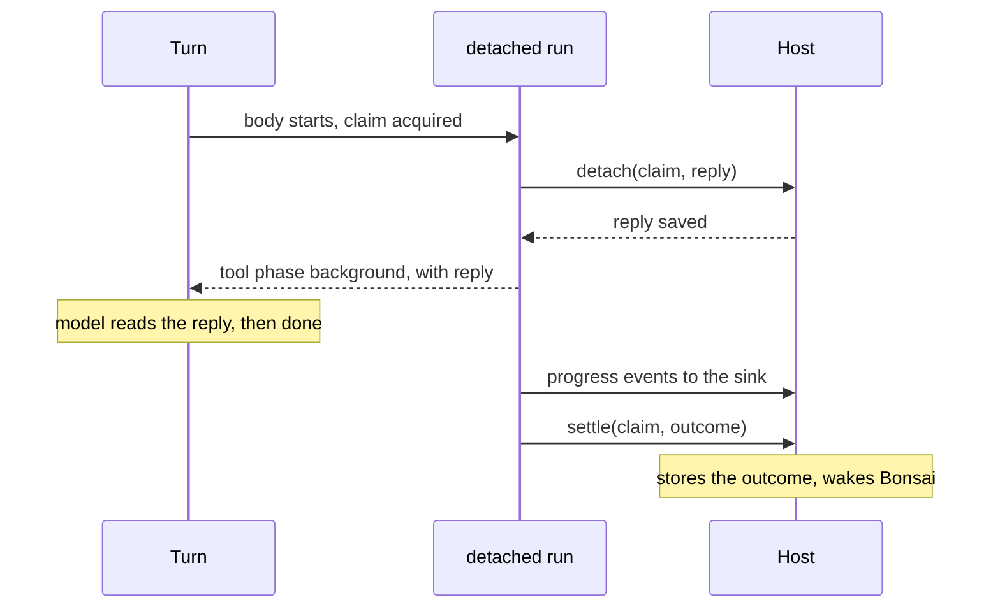

# Background tool calls: answer now, finish later

**Status:** proposal. Nothing is built. Masud chose the option on 2026-10-30. No code until Masud says go.

**Reader:** a Theorem maintainer, Masud, and the Bonsai team.
**Job:** say how a tool call gives the model a reply now, lets the turn go on, and settles after the turn ends.
**After reading:** you know what a host gets, what the kernel must change, and which questions are still open.

Names in this document that the code does not have yet are proposed names: `registerTool.background`, `afterMs`, `tools.modelBackground`, `detach`, `stop`, `drain`, `graceMs`, `tool.background_started`, and the `background` tool phase, result kind and trace link kind.

## 1. The problem

Use a background call when a tool takes longer than a person should wait. Bonsai's thinker (`think_deeply`) runs for about 2 minutes. The turn should reply "looking into it", and the keeper should keep talking. Bonsai's spec is BACKGROUND_JOBS_SPEC.md in the orchidcare repo, sections 3.20 and 4.13.

Today a call runs inside its turn. `docs/contracts/kernel.md` says: "The executor saves settlement before it emits completion." A tool that returns "started" and keeps working settles as done while the work runs.

## 2. The decision

The kernel keeps running the tool body after the turn ends. The host stores the result and decides what to do with it. This matches "host decides, Theorem runs".

The other option was that the host takes over the body. It does not fit, for two reasons:

- `think_deeply` is an agent tool. The kernel runs its nested turn, so a host worker cannot take over.
- `{ after: "10s" }` moves a body that is already running inside the kernel.

A later design can add a host-run body for a job that must survive a restart. It can use the same states.

## 3. What a host gets

Each tool has one setting, `registerTool.background`, beside `registerTool.permission`. Unset means `"never"`, which is what happens today.

| Setting | The model gets its reply |
| --- | --- |
| `"always"` | At the hand-off, when the body starts |
| `{ afterMs: 10000 }` | When the body has run past this time |
| `"never"` | When the body ends |

With `tools.modelBackground` on, the profile lets the model ask for the background on any tool not set to `"never"`. Only then does the kernel add a `background` argument to those tools. It removes the argument before the input check, the hooks and the invocation hash. A tool with its own `background` input reads as `config`.

The body runs the same way in all cases. Only the moment of the reply changes.

If the body ends before that moment, the model reads the real result, as it does today. Bad input, a permission gate and a sign-in gate all happen before the hand-off, so they also answer in the turn.

The reply reaches the turn after the host saves it. The rest of the run goes to the host.

The host supplies a trusted service on `TurnRequest`, in the same way as `execution` and `pageExecution`. Profiles and request bodies cannot inject it. A turn without the service runs every tool inline, whatever its setting, and the model gets no `background` argument. No late result exists, so nothing is lost. One profile can detach on web and run inline on a channel that only hears from the host when it asks.

The service receives:

- a handle for each detached call, with `stop`
- each event of a detached call
- a way to keep the process alive for the run, for a host that needs one

The model reads `tool.background_started` from the label catalog. A profile overrides it through `labels`, as for any other catalog line.

## 4. What the kernel changes

### 4.1 Detach

The kernel reads the `coordinateTool` generator in its own loop. It does not read it from the turn. Before the reply moment, the loop passes events to the turn. After the reply moment, the loop passes events to the host's sink.

`CoordinatedExecution` stays as it is. It still saves settlement before it emits completion, at the real completion. The reply to the model is not completion, so the rule in section 1 stays true.

This changes what the end of a step means. Today `runSideBySide` closes every run that is still open, and `inStep` ends the call. A detached run must stay outside both.

The call's stop signal becomes the call's own. The turn's signal reaches it only until the reply moment. A nested turn takes its signal from the call, so one change covers the children.

The loop wraps `coordinateTool`, so every path that runs a tool gets it: `runTurn`, `invokeTool`, `invokeToolStep` and a live `executeTool`. The service goes on `InvokeToolRequest` too. A gated `"always"` tool therefore detaches when the host resumes it.

The loop handles one event at a time. `settle` waits for the `detach` save, so a body that ends during the save cannot overtake its reply. A failed `detach` save aborts the body, and the call ends as `settlement_write_failed`, as a failed settlement does today. The model never read a reply, so the body must not go on.

### 4.2 A new state

The reply is neither `running` nor `settled`. `ToolExecutionCoordinator` gains `detach(claim, reply)`, and the host saves the reply before the kernel emits it. `BeginToolOperationResult` gains a `background` kind that carries the saved reply. A second run of the same operation then reads the reply and does not fail with `conflict`.

A turn with the service and no coordinator with `detach` reads as `config`, because a late result would have nowhere to go. `pageExecution` follows the same rule: `receivePageAnswer` refuses it with no coordinator. `createMemoryToolExecution` gains `detach`. This is a Breaking Changes entry.

### 4.3 A deliberate stop

A probe on 2026-10-30 ran an agent tool with a child tool, and stopped it through the turn's `signal`:

- The child's `ctx.signal` fired.
- The child marked first, then the parent.
- A child that ignored the signal held the parent until its body ended.
- Both calls ended as `execution_interrupted`, and the turn threw.

So a stop reaches children and the order is correct. But no call settles as stopped. Theorem owns this stop, because only the kernel can tell a stop from a lost worker.

- `stop(reason)` aborts the call's signal. The host names the reason: `stopped` for a later turn, `timed_out` for a system timeout.
- The call settles as a failure with `effects: 'unknown'`. The reason stays in `replay.aborted`, so the host can tell a timeout from a stop.
- A stop after settlement does nothing.
- The host can pass `graceMs`. A body that ignores the signal past this time settles the same way, with the same reason.
- After that settlement the body may still run, because the kernel cannot kill it. `effects: 'unknown'` says so. The kernel drops its late events and result.

This is one exception to the contract rule "An incomplete body or settlement failure retains a protected claim". A second run reads the failure and does not start the body again. Without `graceMs`, a body that ignores the signal holds its claim until it ends.
- The kernel holds the handles in process. Storage and a stop from another worker are the host's. Bonsai's row flag can stay, and its poller calls `stop`.

### 4.4 Lost work

`CoordinatedExecution.close` still marks `execution_interrupted` and `settlement_write_failed`, after the turn too. The kernel does not write `worker_lost`: the host's sweep writes it for a claim with no live worker.

A shutdown is not a stop. A host on shutdown calls `drain`. It aborts each detached call with no reason, and `close` marks each one `execution_interrupted`. The host reads this as "cut off", not as "stopped" or "timed out".

### 4.5 After the turn

- `post_tool` runs at the real end. It cannot inject or abort, because no turn is open.
- The agent tool's tokens go on the late `complete` event, because `done` has already gone out.
- The late work writes its own trace record. It links to the turn through `TurnTraceLink`, with a new kind, `background`.

### 4.6 Nested calls

Only a top-level call detaches. A tool inside an agent tool runs inline, so a parent never settles before its children. A child's operation ID has no link to its parent today, and this design does not need one.

### 4.7 Live sessions

Live calls already run while the model speaks, so the same loop fits. A live session has no per-call signal today, so a detached call adds one. `answerModel` throws after the session closes, so a settlement after close goes to the coordinator only. The host tells the person.

### 4.8 Clients

The `background` phase joins the exhaustive switch in `src/interface/tool-calls.ts`, so a client shows the call as running on. Events on the sink go to the host only. The host decides what a client sees of them.

### 4.9 Tools that cannot detach

A tool with `answeredBy: 'page'` and a `background` setting reads as `config`. Provider built-in tools have no body in the kernel, so the setting does not apply to them.

## 5. Limits a host must know

- **The host keeps the turn's services valid until settlement.** The call still uses the `host` value, `credentials`, `onStage`, `onAgentCall` and the provider options. `ToolCredentialSource` is read per slot and takes refreshed tokens, so a long job keeps working. A `host` value tied to the request does not.
- **The work is process-bound.** It stops with the process and does not restart. The claim stays open for the host's sweep.
- **A Worker host cannot run a long job.** A Container can.
- **`maxOutcomeBytes` covers the final outcome only.** A larger result settles as `result_too_large`, and the result is lost. Set it high for a long agent tool, or leave it unset.
- **Theorem's own web host refuses native resumption during a job.** `web/src/server/session-boundary.ts` refuses it while an operation is not settled. A detached call must count as answered there.

## 6. Settled by existing rules

| Question | Answer | Rule |
| --- | --- | --- |
| How does the late result reach the model? | The host reads the outcome and passes it in `input.context` or `input.history`. The kernel adds no input. A job that ends during a turn joins through the host's inject | "Host decides, Theorem runs". Detectors already read those boundaries |
| Does the setting sit on the tool or the profile? | The tool, beside `registerTool.permission`. The profile switches on the model's ask | The tool catalog holds per-tool behaviour. Opt-in features stay off when unset |
| Does a `"never"` tool refuse the model? | Yes. No argument appears on it | Bonsai's spec, section 3.20 |
| Does a stop in the chat stop the job? | Only if the host calls `stop`. The turn's signal stops at the reply | "Host decides, Theorem runs" |
| What if a body asks for a sign-in after the reply? | It ends as `execution_interrupted`, through `gateAfterClaim`, as it does for any gate after a claim. Agent tools refuse sign-in tools at registration | Existing coordinator rule |
| What if a planned `guardrails.taint.write: 'ask'` fires in a job? | It refuses in any nested turn, inline or detached. No one can answer there | Agent tools already refuse any tool that can stop on a gate |
| Can a host limit jobs or refuse a repeat? | Yes, with a `pre_tool` stage that answers `deny` | No invented limits. The hook exists |

## 7. Open

**Taint across turns.** This does not block the design. A settled outcome already keeps `provenance` and `suspicious`, so a host has them for the late result. Taint itself still ends with the turn, for a late result and for any earlier remote read. That decision is separate.
