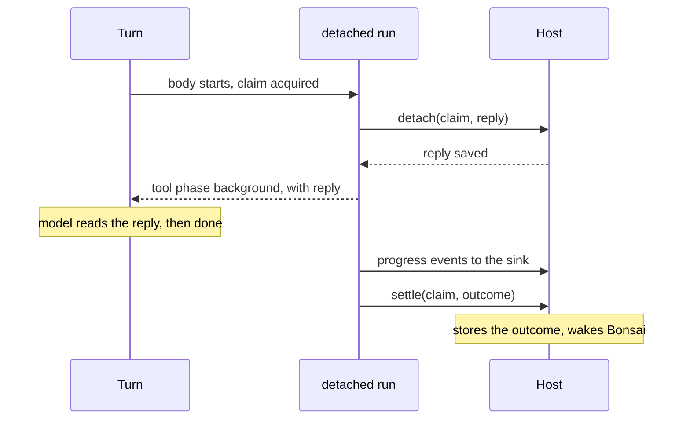

# Background tool calls: answer now, finish later

**Status:** proposal. Nothing is built. Masud chose the option on 2026-10-30. No code until Masud says go.

**Reader:** a Theorem maintainer, Masud, and the Bonsai team.
**Job:** say how a tool call gives the model a reply now, lets the turn go on, and settles after the turn ends.
**After reading:** you know what a host gets, what the kernel must change, and which questions are still open.

Names in this document that the code does not have yet are proposed names: `registerTool.background`, `afterMs`, `detach`, `stop`, `graceMs`, `tool.background_started`, the `background` tool phase and result kind, and the host's stop reasons.

## 1. The problem

Use a background call when a tool takes longer than a person should wait. Bonsai's thinker (`think_deeply`) runs for about 2 minutes. The turn should reply "looking into it", and the keeper should keep talking. Bonsai's spec is BACKGROUND_JOBS_SPEC.md in the orchidcare repo, sections 3.20 and 4.13.

Today a call runs inside its turn. `docs/contracts/kernel.md` says: "The executor saves settlement before it emits completion." A tool that returns "started" and keeps working settles as done while the work runs.

## 2. The decision

The kernel keeps running the tool body after the turn ends. The host stores the result and decides what to do with it. This matches "host decides, Theorem runs".

The other option was that the host takes over the body. It does not fit, for two reasons:

- `think_deeply` is an agent tool. The kernel runs its nested turn, so a host worker cannot take over.
- `{ after: "10s" }` moves a body that is already running inside the kernel.

A later design can add a host-run body for a job that must survive a restart. It can use the same states.

## 3. What a host gets

Each tool has one setting, `registerTool.background`, beside `registerTool.permission`. Unset means `"never"`, which is what happens today.

| Setting | The model gets its reply |
| --- | --- |
| `"always"` | At the hand-off, when the body starts |
| `{ afterMs: 10000 }` | When the body has run past this time |
| `"ask"` | At the hand-off if the model asks. Otherwise when the body ends |
| `"never"` | When the body ends |

Only an `"ask"` tool gets a `background` argument, so unset tools and their schemas do not change. The argument stays in the call and its invocation hash, so it survives a gate. The kernel removes it before the input check. A tool with its own `background` input reads as `config`.

The body runs the same way in all cases. Only the moment of the reply changes.

If the body ends before that moment, the model reads the real result, as it does today. Bad input, a permission gate and a sign-in gate all happen before the hand-off, so they also answer in the turn.

The reply reaches the turn after the host saves it. The rest of the run goes to the host.

The host supplies a trusted service on `TurnRequest`, `InvokeToolRequest` and `SessionRequest`, in the same way as `execution` and `pageExecution`. Profiles and request bodies cannot inject it.

A turn without the service runs every tool inline, whatever its setting, and the model gets no `background` argument. No late result exists, so nothing is lost. One profile can detach on web and run inline on a channel that only hears from the host when it asks.

The service receives:

- a handle for each detached call: `{ stop(reason?, { graceMs }), done }`
- each event of a detached call, after the same projection a turn's events get

`done` resolves when the call has settled or been marked. A host that must stay alive awaits it.

The model reads `tool.background_started` from the label catalog. A profile overrides it through `labels`, as for any other catalog line.

## 4. What the kernel changes

### 4.1 Detach

The run stays in `coordinateTool`. `CoordinatedExecution` already holds the claim, so it decides when the reply happens and orders it against settlement.

- `"always"` and an `"ask"` the model used fire through `onDispatch`.
- `{ afterMs }` runs a timer against the body. The timer stops when the body ends, before `post_tool`.
- At the reply, `coordinateTool` saves it, yields the `background` event and returns to the turn. A task it started keeps reading the run, and passes events to the sink.

`finish` still saves settlement before it emits completion, at the real completion. The reply to the model is not completion, so the rule in section 1 stays true. `settle` waits for the `detach` save, because both run in order inside `CoordinatedExecution`.

A failed `detach` save aborts the body, and the call ends as `settlement_write_failed`, as a failed settlement does today. The model never read a reply, so the body must not go on.

The step counts the call as settled at its reply. `waitFor` and one-at-a-time order release there, and the turn is not held open. This changes the contract's "The step ends when each has settled". A sibling's failure before the reply closes the run as today. After the reply it does not reach the run.

The call's stop signal becomes the call's own, and the stages read it too. The turn's signal reaches it only until the reply. A nested turn takes its signal from the call, so one change covers the children.

`coordinateTool` runs every tool, so every path gets this: `runTurn`, `invokeTool`, `invokeToolStep` and a live `executeTool`. A gated `"always"` tool detaches when the host resumes it.

### 4.2 A new state

The reply is neither `running` nor `settled`. `ToolExecutionCoordinator` gains an optional `detach(claim, reply)`, and the host saves the reply before the kernel emits it. `BeginToolOperationResult` gains a `background` kind that carries the saved reply event and model result. A second run reads the settled result if one exists, and the reply if not.

A turn with the service and no coordinator with `detach` reads as `config`, because a late result would have nowhere to go. `pageExecution` follows the same rule: `receivePageAnswer` refuses it with no coordinator. `createMemoryToolExecution` gains `detach`.

### 4.3 A deliberate stop

A probe on 2026-10-30 ran an agent tool with a child tool, and stopped it through the turn's `signal`:

- The child's `ctx.signal` fired.
- The child marked first, then the parent.
- A child that ignored the signal held the parent until its body ended.
- Both calls ended as `execution_interrupted`, and the turn threw.

So a stop reaches children and the order is correct. But no call settles as stopped. Theorem owns this stop, because only the kernel can tell a stop from a lost worker.

- `stop(reason)` aborts the call's signal. The host names the reason, such as `stopped` for a later turn or `timed_out` for a system timeout.
- After a stop the call settles with that reason, whatever the body does. The reason is the failure's `code`, with kind `cancelled` and `effects: 'unknown'`. `finish` builds this failure, as `withinLimit` builds `result_too_large`.
- A body that throws, or one that returns in the same moment, settles the same way. Any late result is dropped.
- A stop after settlement does nothing.
- With `graceMs`, a body that ignores the signal past this time settles the same way. The kernel does not wait on it again.
- After that settlement the body may still run, because the kernel cannot kill it. `effects: 'unknown'` says so. The kernel drops its late events.

This is one exception to the contract rule "An incomplete body or settlement failure retains a protected claim". A second run reads the failure and does not start the body again. Without `graceMs`, a body that ignores the signal holds its claim until it ends.

The kernel holds the handles in process. Storage and a stop from another worker are the host's. Bonsai's row flag can stay, and its poller calls `stop`.

### 4.4 Lost work

`CoordinatedExecution.close` still marks `execution_interrupted` and `settlement_write_failed`, after the turn too. The kernel does not write `worker_lost`: the host's sweep writes it for a claim with no live worker.

A shutdown is not a stop. A host on shutdown calls `stop()` with no reason, and awaits `done`. The call then ends as `execution_interrupted`, whatever the body does. The host reads this as "cut off", not as "stopped" or "timed out".

### 4.5 After the turn

- `post_tool` runs at the real end. It can change the result. It cannot inject or abort, because no turn is open, so the kernel removes those before it saves the outcome.
- A body that returns `awaiting` after the reply settles as a failure. No turn can pause.
- The agent tool's tokens go on the late `complete` event, because `done` has already gone out. The `done.tokens` comment on that field changes to match.
- A call that may detach gets its own trace from the start, joined to the turn through `traceparent`. It writes its record at the real end. A span in the turn's tree cannot outlive the turn, because `collect` closes it as unclosed.

### 4.6 Nested calls

Only a top-level call detaches. A tool inside an agent tool runs inline, so a parent never settles before its children. A child's operation ID has no link to its parent today, and this design does not need one.

### 4.7 Live sessions

Live calls already run while the model speaks, so the same path fits. A live session has no per-call signal today, so a detached call adds one. `answerModel` throws after the session closes, so a settlement after close goes to the coordinator only. The host tells the person.

### 4.8 Clients

The `background` phase carries `readBack` and counts as settling the call for the turn. `settlesToolCall` gains it, and `src/interface/history.ts`, `src/kernel/tools/run.ts` and the live answer path read that one predicate. The history then keeps the tool pair, and a resumed call does not come back as `invoke_failed`.

Events on the sink go to the host only. The host decides what a client sees of them.

### 4.9 Tools that cannot detach

A `background` setting reads as `config` on a tool with `answeredBy: 'page'` and on a `tools.t2Loader` tool, which must change a turn that is still open. Provider built-in tools have no body in the kernel, so the setting does not apply to them.

## 5. Limits a host must know

- **The host keeps the turn's services valid until settlement.** The call still uses the `host` value, `credentials`, `onStage`, `onAgentCall` and the provider options. `ToolCredentialSource` is read per slot and takes refreshed tokens, so a long job keeps working. A `host` value tied to the request does not.
- **The work is process-bound.** It stops with the process and does not restart. The claim stays open for the host's sweep.
- **A Worker host cannot run a long job.** A Container can.
- **`maxOutcomeBytes` covers the final outcome only.** A larger result settles as `result_too_large`, and the result is lost. Set it high for a long agent tool, or leave it unset.
- **A stopped agent tool reports no tokens.** `nested.ts` throws before it reads the child's usage.
- **`@theoremjs/web` does not pass the service in the first build.** Its tools run inline. A checkpoint hashes each operation's status, and `requireOwnedCheckpoint` compares each settled read-back with the history, so a job that settles late would invalidate it. Web support is a later contract change.

## 6. Settled by existing rules

| Question | Answer | Rule |
| --- | --- | --- |
| How does the late result reach the model? | The host reads the outcome and passes it in `input.context` or `input.history`. The kernel adds no input. A job that ends during a turn joins through the host's inject | "Host decides, Theorem runs". Detectors already read those boundaries |
| Does the setting sit on the tool or the profile? | The tool, beside `registerTool.permission` | The tool catalog holds per-tool behaviour |
| Can the model background any tool? | Only one set to `"ask"` | Opt-in features stay off when unset |
| Does a stop in the chat stop the job? | Only if the host calls `stop`. The turn's signal stops at the reply | "Host decides, Theorem runs" |
| What if a body asks for a sign-in after the reply? | It ends as `execution_interrupted`, through `gateAfterClaim`, as it does for any gate after a claim. Agent tools refuse sign-in tools at registration | Existing coordinator rule |
| What if a planned `guardrails.taint.write: 'ask'` fires in a job? | It refuses in any nested turn, inline or detached. No one can answer there | Agent tools already refuse any tool that can stop on a gate |
| Can a host limit jobs or refuse a repeat, such as a validation retry that calls the tool again? | Yes, with a `pre_tool` stage that answers `deny` | No invented limits. The hook exists |

## 7. Open

**Taint across turns.** This does not block the design. A settled outcome already keeps `provenance` and `suspicious`, so a host has them for the late result. Taint itself still ends with the turn, for a late result and for any earlier remote read. That decision is separate.
