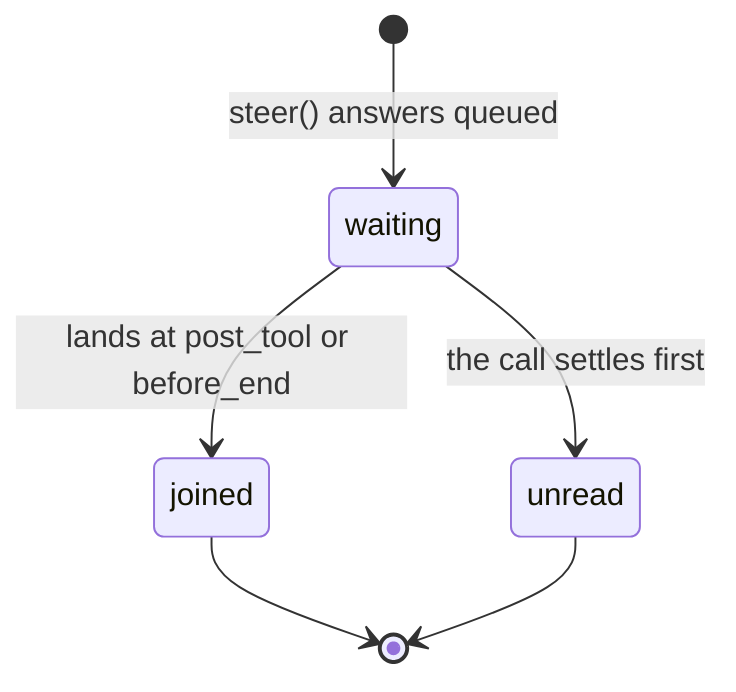

# Steer a background call: tell a running agent tool something new

**Status:** proposal. Masud chose this option on 2026-11-04. No code exists yet. Names in this document that the code does not have yet are marked *(new)*.

**Reader:** a Theorem maintainer, Masud, and the Bonsai team.
**Job:** say how a host gives a detached agent tool call a new message while it runs.
**After reading:** you know what a host gets, what the kernel changes, and what was proven before the design.

## 1. The problem

A detached call runs after its turn ends (see [Background tool calls](background-tool-calls.md)). Today the host can only stop it.

Bonsai's case: a keeper asks for deep research on thrips. Bonsai starts `think_deeply`, which detaches. Two minutes later the keeper says "it's on the monstera, not the fern". Bonsai can stop the job and start again, and lose two minutes of work. Or it can let the job finish with the wrong plant. Bonsai's spec, BACKGROUND_JOBS_SPEC.md section 3.4 in the orchidcare repo, said "Bonsai cannot talk to a running job". Masud reopened that decision on 2026-11-04.

The host needs a third choice: tell the job the new fact, and let it go on.

## 2. Why a steer can reach a job at all

Background tool calls, section 4.5, says a detached call's `post_tool` cannot inject, "because no turn is open". That is the caller's turn. An agent tool runs its own turn, and that turn stays open until the job ends. Its stages run the whole time, and they take injects as any text turn does.

A probe on 2026-11-04 proved this on the current kernel. It ran a detached agent tool whose called turn got an inject through the host's `onAgentCall` hook (a stage handler returned by `AgentCallRequest`):

| Where the inject came | What happened |
| --- | --- |
| `post_tool`, after the job's first tool call | It landed. The job's next model call read it |
| `before_end`, after the job wrote its answer | It landed. The job made one more model call with it |
| `post_tool` on the job's last step (`maxSteps` reached) | It was refused. The job ended without it |

In both landed cases the host's service received the called turn's `stage` event with `injected` naming the inject's id. It arrived as a `progress` event of the detached call, through `ToolBackgroundService.event`.

So the mechanism exists. This design gives it a contract.

## 3. The decision

The kernel adds `steer` to `ToolBackgroundHandle`. A steer joins the job's own turn through the same inject path as a mid-turn message.

The other option was to leave it to the host, with the hook from section 2. It works, but each host must then build the same parts again, and two of them only the kernel can do exactly:

- **Too late.** Only the kernel knows that a waiting steer never landed before the call settled. A host can only guess from a missing event, and a failed event sink makes that guess wrong.
- **Refused at once.** Only the kernel knows, at the moment of the steer, that the call is not an agent tool, has settled, or runs a profile with steering off.

The hook also runs at every stage of every called turn, for every host, whether or not anything waits. The kernel's queue costs nothing when it is empty.

## 4. What a host gets

```ts
interface ToolBackgroundHandle {
  stop(reason?: string, options?: { graceMs?: number }): void; // today
  steer(text: string, options: { id: string }): ToolSteerReceipt; // new
  done: Promise<ToolBackgroundSettled>; // was Promise<void>
}

type ToolSteerReceipt = // new
  | { queued: true }
  | { queued: false; reason: 'settled' | 'stopped' | 'not_agent' | 'steering_off' };

interface ToolBackgroundSettled { // new
  /** Ids of steers that were queued and never landed. */
  unreadSteers: string[];
}
```

A steer goes through three states:



- **Waiting.** `steer` answers `{ queued: true }`. The steer waits for the job turn's next stage that takes an inject: `post_tool` or `before_end` (see `STAGE_AFFORDANCE_MATRIX`). It does not cut a model call that is running.
- **Joined.** The kernel lands the steer as a user message, with its id as the `InjectUnit` id. The job turn emits its `stage` event with `injected`, and the host gets it as in section 2. The next model call reads it.
- **Unread.** If the call settles with the steer still waiting, the id is in `unreadSteers` *(new)* when `done` resolves. This includes a stop, and a job on its last step, where `injectWouldExceedMaxSteps` refuses every inject.

A steer that the kernel refuses at once answers `{ queued: false }` with a reason:

| Reason | When |
| --- | --- |
| `settled` | The call has settled or been marked |
| `stopped` | The host called `stop` and the call has not settled yet |
| `not_agent` *(new)* | The call is a function tool. It has no turn to steer |
| `steering_off` *(new)* | `profileAllowsInject` is false for the called agent's profile, for example `turnBehaviour.allowSteering: false` |

The gate is the called profile's own. A tool has no second switch beside it.

## 5. What the kernel changes

### 5.1 The queue rides with the call

`CoordinatedExecution.detach` builds the handle. The job turn runs inside `executeAgentTool`, under `AgentCaller.run`. The call's `signal` already goes this way. The steer queue goes with it:

- `CoordinatedExecution` creates the queue when it takes the claim, and `steer` writes to it.
- The handler's `ToolContext` carries the queue beside `signal`. `executeAgentTool` passes it to `AgentCaller.run`.
- `createAgentCaller` passes it to `RunNestedTurn` beside `agentDepth`. `TurnRequest` does not change, so a request body cannot set it.

### 5.2 Where steers land

At `post_tool` and `before_end` of the job turn, the kernel adds the waiting steers to the injects of that stage, after the host's own. They go through `runStage`, so the profile's guardrails sanitize them as any inject. A steer leaves the queue only when its messages land. A stage that refuses the inject leaves it waiting.

### 5.3 Reach

A steer reaches the job's own turn only. The job's own agent tool calls run inline (Background tool calls, section 4.6), and their `ToolContext` does not get the queue. A child that needs the new fact gets it from its parent, as it gets its input.

### 5.4 Settlement

When the call settles or is marked, the kernel closes the queue and resolves `done` with the ids still waiting. A steer after that answers `settled`. `done` changes from `Promise<void>` to `Promise<ToolBackgroundSettled>`; code that only awaits it does not change.

### 5.5 Before the reply

The host gets the handle only at the hand-off, through `ToolBackgroundService.detached`. Before that the call is part of an open turn, and a mid-turn message goes to that turn as it does today.

## 6. Tests

- Each row of the section 2 table, through `steer` instead of a hook: the steer lands at `post_tool`, lands at `before_end`, and is unread at the step limit.
- The `injected` event names the steer's id, and the host's service gets it.
- Each refusal reason, from a real call in that state.
- A stop with a steer waiting: `done` lists it as unread.
- A child agent tool of the job never reads the steer.
- A steer passes the profile's guardrails like a host inject.
- An empty queue changes no stage of any turn.

## 7. What the Bonsai side does

This is the host's part, in the orchidcare repo. It is listed so the contract can be checked against a real host.

```ts
// Bonsai's manage_action tool gains a kind beside stop:
{ kind: "tell", target_id, message }
// It answers that the message waits, or job_not_running.
```

- The message is saved on the job's row in Bonsai's agent_operations table. The brain that runs the job reads it within a tick, as it reads a stop, and calls `steer` with the message's id.
- Each message goes from waiting to joined or too late. Bonsai shows the state in the running-jobs context and in the job's wake.
