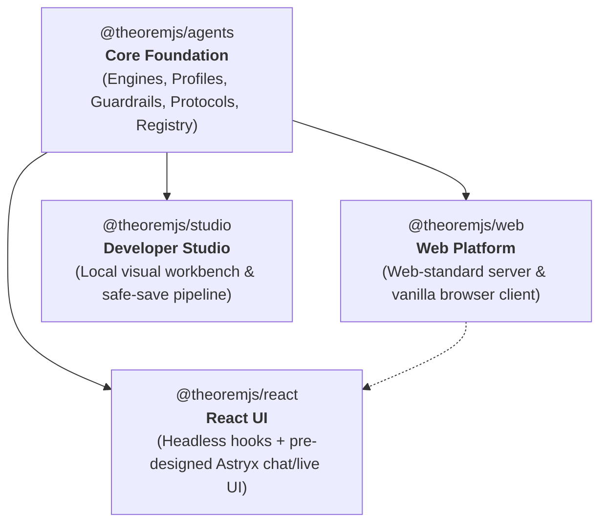

# 1.1 Getting Started

Theorem is a host-owned TypeScript agent platform. It executes agent turns from strictly typed profiles, enforces boundary guardrails, gates tool calls, and validates structured outputs on every request.

---

## The Four Packages

Theorem is structured as four distinct packages, with `@theoremjs/agents` serving as the foundational engine at the top of the stack:



| Package | Role | What it delivers |
| :--- | :--- | :--- |
| **`@theoremjs/agents`** | **The Foundation** | The core runtime: typed profile registry, turn runner, first-class engines (Text, Live, Decision, Embedding), boundary guardrails, tool execution, and protocol adapters. |
| **`@theoremjs/web`** | **Web Standards** | Framework-agnostic server handlers (`@theoremjs/web/server`) and vanilla browser clients (`@theoremjs/web/client`) with zero UI framework dependencies. |
| **`@theoremjs/react`** | **React Integration** | Headless client hooks (`useAgentChat`, `useLiveSession`), server handlers, and pre-designed Astryx chat transcripts, voice visualizers, and trace inspectors. |
| **`@theoremjs/studio`** | **Visual Workbench** | Local development environment for authoring profiles, visualizing agent graphs, and testing turns with three-proof safe saves. |

---

## Installation

Install the foundational kernel and Zod:

```bash
# npm
npm install @theoremjs/agents zod

# deno
deno add jsr:@theoremjs/agents
```

### Additional Packages

Depending on what you are building:

```bash
# Web-standard server handlers & vanilla browser client (no UI framework)
npm install @theoremjs/web

# React hooks & pre-designed Astryx chat and live UI
npm install @theoremjs/react @astryxdesign/core

# Developer studio (visual authoring & embedded studio screens)
npm install @theoremjs/studio
```

---

## Quick Start: The First Turn

In Theorem, an agent is defined once as a **profile**. The profile bundles the agent's identity, models, allowed tools, input constraints, and output expectations into a single immutable contract.

An agent does not need tools to run. We start with a focused, conversational desk agent for **Harbor**, a logistics platform.

### 1. Define the Profile

`defineProfile` validates the agent contract at application startup. It guarantees that required fields are set and conforms strictly to the profile's type:

```ts
import {
  defineProfile,
  openRouterProvider,
  registerProfile,
  registerProvider,
} from '@theoremjs/agents';

// Register the provider protocol
registerProvider(openRouterProvider);

const deskProfile = defineProfile({
  type: 'text',
  id: 'harbor.desk',
  identity: {
    handle: 'desk',
    system: 'You are the Harbor logistics desk. Provide concise, direct operational answers.',
  },
  models: {
    main: {
      protocol: 'openRouterOpenAi',
      provider: 'openrouter',
      apiId: 'openrouter/free',
      keySlot: 'openrouter',
    },
  },
  tools: {
    allow: [],
  },
  inputs: {
    text: true,
  },
});

registerProfile(deskProfile);
```

#### The `models` Schema
Each entry under `models` is a strictly validated `ModelBinding`:
* **`protocol`** *(required)*: The wire format and streaming dialect (e.g. `'openRouterOpenAi'`, `'geminiInteractions'`).
* **`provider`** *(required)*: The registered service that handles connection and transport (`'openrouter'`, `'gemini'`, `'local'`).
* **`apiId`** *(required)*: The model identifier known to the provider (`'openrouter/free'`, `'gemini-2.5-flash'`).
* **`keySlot`** *(optional)*: The name of the vault slot supplying the API credential. Defaults to the provider's primary key slot.
* **`fallbackKeySlot`** *(optional)*: Secondary key slot used when the primary key runs out of quota.
* **Settings** *(optional)*: Optional tuning such as `temperature`, `maxOutputTokens`, `efforts`, `builtInTools`, and `compaction`.

---

### 2. Supply the Vault & Run the Turn

Credentials never live inside profiles. Instead, the profile declares a **key slot** (`keySlot: 'openrouter'`). At execution time, your host supplies keys via an isolated **vault**:

```ts
import { runTurn } from '@theoremjs/agents';

const hostOptions = {
  vault: {
    openrouter: process.env.OPENROUTER_API_KEY,
  },
};

const turnRequest = {
  profile: 'harbor.desk',
  input: {
    text: 'What documentation is typically needed for international freight?',
  },
};

for await (const event of runTurn(turnRequest, hostOptions)) {
  if (event.type === 'text') {
    process.stdout.write(event.text);
  }
}
```

---

### 3. Add Capabilities: Register a Tool

When an agent needs real-time data or actions beyond its instruction, you register a tool and add it to the profile's `tools.allow` list:

```ts
import { registerTool } from '@theoremjs/agents';
import { z } from 'zod';

registerTool({
  type: 'function',
  name: 'harbor_holdStatus',
  description: 'Look up why a Harbor shipment is currently on hold.',
  category: 'ops',
  access: 'read-only',
  paths: ['*'],
  loadTier: 'T0',
  permission: 'auto',
  input: z.object({ shipmentId: z.string() }),
  output: z.object({ status: z.string(), reason: z.string() }),
  handler: ({ shipmentId }) => ({
    status: 'hold',
    reason: `Shipment ${shipmentId} requires commercial invoice customs clearance.`,
  }),
});
```

To give the desk access, update the profile's `tools.allow`:

```ts
const deskWithTools = defineProfile({
  ...deskProfile,
  tools: {
    allow: ['harbor_holdStatus'],
  },
});

registerProfile(deskWithTools);
```

---

## The Profile is the Hard Boundary

In Theorem, a runtime request can **never** exceed what the profile declares:

1. **Model Selection**: If a client request sends `{ model: 'gpt-4o' }`, Theorem refuses the request immediately unless the profile explicitly sets `allowModelSelect: true`.
2. **Tool Scope**: The model can only see and execute tools explicitly listed in `tools.allow`.
3. **Inputs & Slots**: Input text, attachments, voice clips, or context slots are rejected if the profile does not explicitly declare them.

### What Happens When a Request Overreaches?

```ts
import { runTurn, TheoremError } from '@theoremjs/agents';

try {
  await runTurn(
    {
      profile: 'harbor.desk',
      model: 'unauthorized-model',
      input: { text: 'Hello' },
    },
    hostOptions,
  );
} catch (error) {
  if (error instanceof TheoremError) {
    console.error(`Refused [${error.kind}]: ${error.message}`);
    // Output: Refused [config]: Profile harbor.desk does not allow model selection
  }
}
```

`runTurn` throws a typed `TheoremError` **before** any network call or model interaction occurs.
