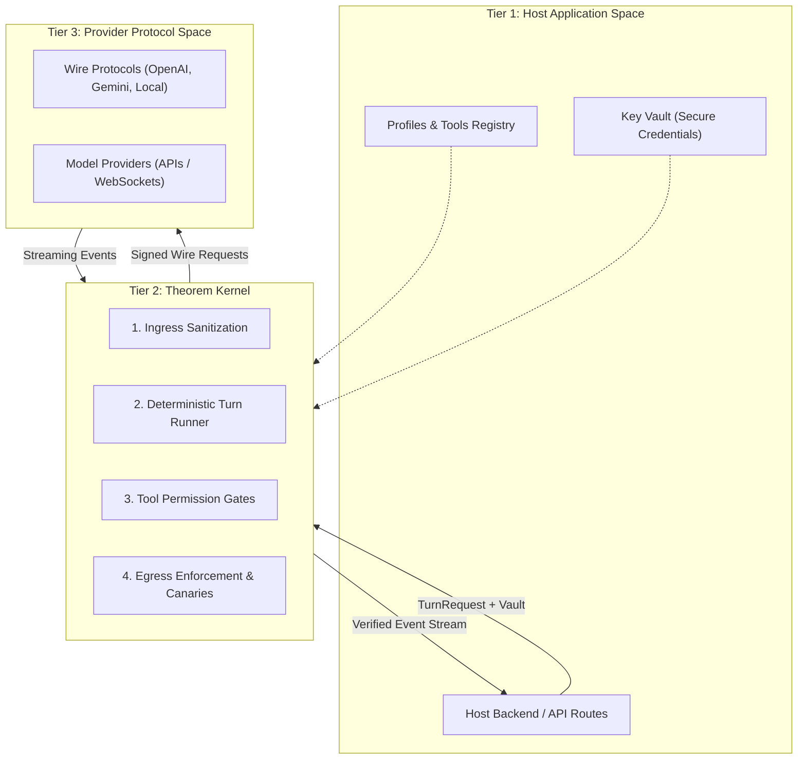
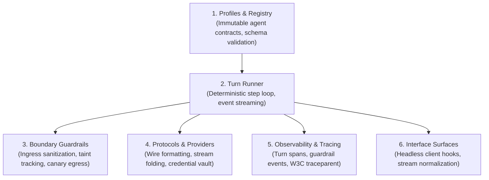
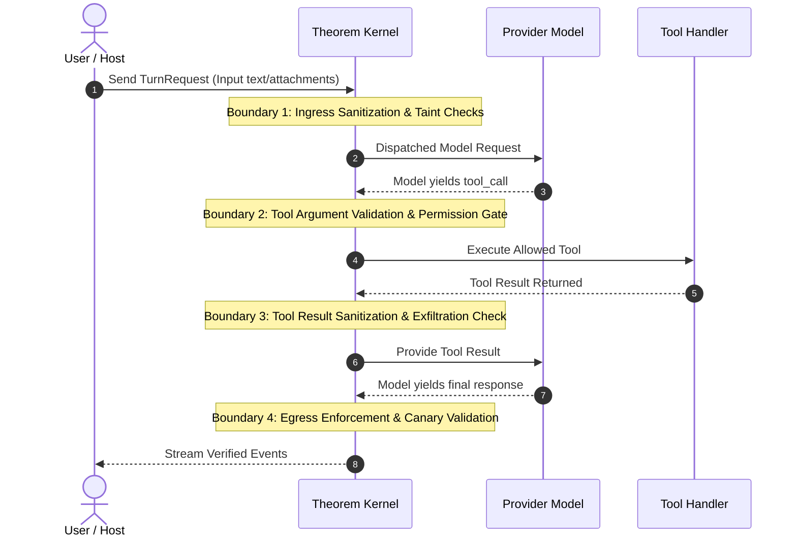

# 1.2 Architecture & Contracts Map

Theorem is architected around two core invariants that separate application policy from execution mechanics.

---

## The Core Invariants

### 1. "Host decides, Theorem runs"

In traditional AI application frameworks, the framework often makes implicit decisions: it silently injects system prompts, chooses retry strategies, modifies user input, or logs to unconfigured destinations.

Theorem reverses this hierarchy:
* **The Host owns all policy**: Identity, personas, allowed models, tool access, rate limits, and custom guardrails are defined explicitly by the host application.
* **Theorem enforces without deviation**: Two applications shipping contradictory products can execute against the same Theorem kernel version without compromise. No model or end-user can observe a decision that the host did not author.

### 2. Zero Ambient Authority

Theorem operates with no ambient authority:
* Modules construct and load with **zero side effects**.
* The kernel does not read `process.env` or file paths implicitly.
* Credentials exist only in explicit vaults supplied at turn invocation.
* Remote network requests are guarded against SSRF and private network access (`resolveHost`).

---

## The Three-Tier System Model

Every Theorem deployment follows a strict three-tier boundary:

1. **Host Application Space**: Owns the profiles, tool handlers, and API key vaults. It initiates requests via `runTurn`.
2. **Theorem Kernel**: The deterministic engine. It intercepts the request, runs ingress sanitization, executes the step loop, gates tool calls, and performs egress validation before yielding events back.
3. **Provider Protocol Space**: Converts normalized kernel requests into provider-specific wire schemas (`http` or `ws`) and streams raw events back into the kernel.

---

## Core Subsystem Architecture

Theorem organizes turn execution into six coordinated subsystems:

| Subsystem | Scope | Core Responsibility |
| :--- | :--- | :--- |
| **Profile Registry** | `defineProfile`, `registerProfile` | Validates agent definitions at startup, enforces schema boundaries, and maintains immutable profile configurations. |
| **Turn Runner** | `runTurn`, `invokeTool` | Orchestrates the multi-step execution loop, tool dispatch, stream event generation, and turn continuation. |
| **Boundary Guardrails** | `profile.guardrails` | Inspects text at all four physical boundaries: disarming injections, gating confused deputies, and blocking canary exfiltration. |
| **Protocols & Providers** | `registerProvider`, `defineProvider` | Maps normalized turn payloads into upstream wire formats, folds SSE streams, and resolves credentials from the vault. |
| **Observability** | `profile.observability` | Emits structured telemetry, OpenTelemetry-compatible turn spans, and distributed trace headers. |
| **Interface Surfaces** | `@theoremjs/web`, `@theoremjs/react` | Normalizes stream events, provides headless React hooks (`useAgentChat`, `useLiveSession`), and renders conversation UI. |

---

## Turn Lifecycle & Boundary Crossings

Every turn executed by `runTurn` moves through four distinct validation checkpoints:

1. **Boundary 1 (Input)**: Ingress sanitization inspects the user message, files, and context. Placeholders replace sensitive data; injected instructions are disarmed.
2. **Boundary 2 (Tool Call)**: Tool arguments are validated against the tool's input schema and evaluated against the profile's permission gates (`auto`, `session_consent`, `always_confirm`).
3. **Boundary 3 (Tool Result)**: Tool results are inspected before returning to the model to prevent taint leakage.
4. **Boundary 4 (Egress)**: The model's proposed final output is evaluated for canary token leakage or private system prompt extraction before being released to the client.

---

## Why Profiles Prevent Architectural Drift

In typical LLM implementations, agent configuration is fragmented across routes, middleware, and helper files:
* Prompt engineering lives in a template file.
* Model options live in an API client setup.
* Tool definitions live in route handlers.
* Input validation lives in controller middleware.

Over time, these components inevitably fall out of sync: a route accepts an attachment format that the model cannot parse, or a prompt references a tool that is no longer exposed.

In Theorem, **the profile is the single source of truth**. Every model parameter, allowed tool, accepted mime type, and guardrail setting is co-located in the profile definition. Changing the profile updates the entire pipeline simultaneously, ensuring that code and agent behavior never drift apart.
