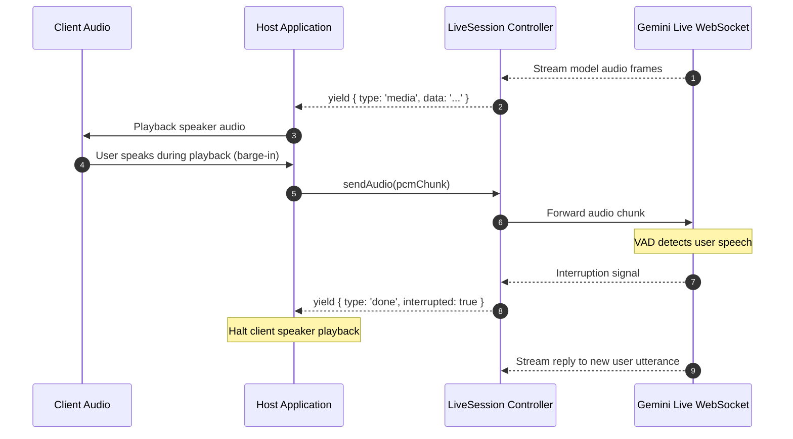
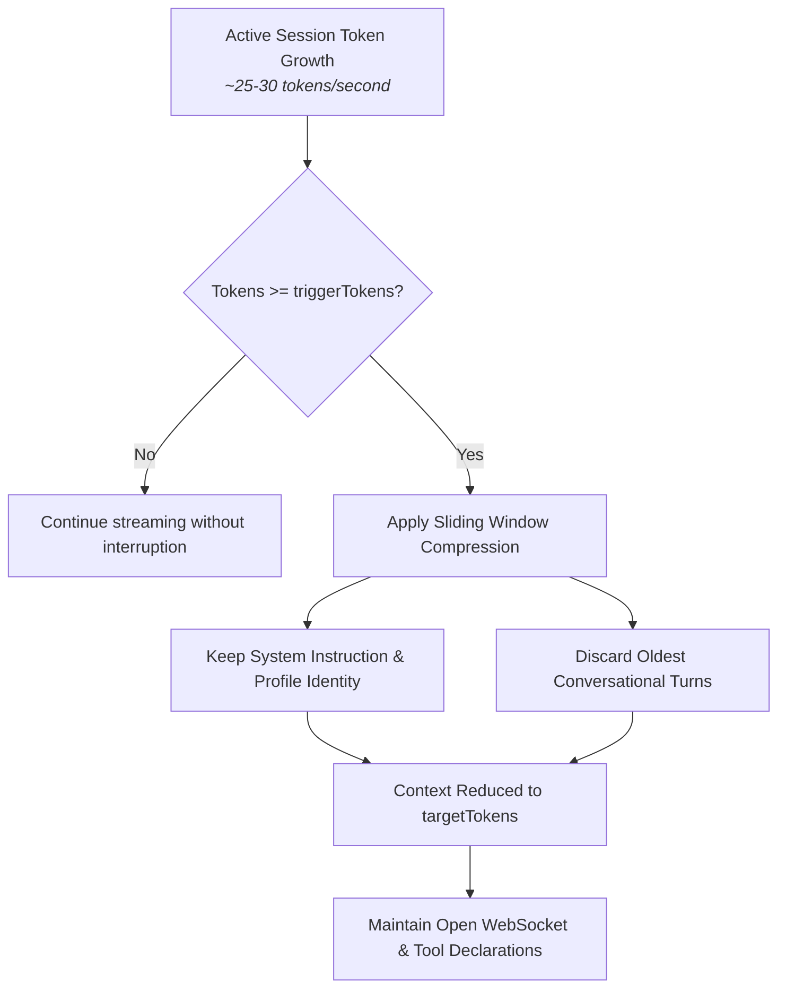

# Live Profiles & runSession()

Live profiles (`type: 'live'`) configure realtime agents that communicate over bidirectional WebSockets using audio, camera frames, and typed text. They are opened with `runSession()`, which establishes a persistent provider socket, coordinates voice activity detection and user barge-in, compresses conversation context for long sessions, and executes tools during live conversations.

---

## Live Profile Configuration

Base profile fields (`identity`, `models`, `tools`, `guardrails`, `observability`) apply across all modalities as documented in [Profiles](2-1-profiles.md). Live profiles connect over bidirectional WebSockets using Gemini's Multimodal Live API (the currently supported live provider). They declare a dedicated `live` block configuring audio settings, ingress channels, interruption policies, and context window compression:

```ts
import { defineProfile } from '@theoremjs/agents';

export const liveDispatch = defineProfile({
  type: 'live',
  id: 'harbor.live_dispatch',
  // ... identity, models, tools

  live: {
    voice: 'Aoede',
    ingress: {
      audio: true,  // Accept microphone PCM audio (default: true)
      video: true,  // Accept webcam JPEG frames (default: true)
      text: false,  // Accept typed text messages (default: false)
    },
    vad: {
      activityHandling: 'interrupt_speaking', // Halt model speech on user barge-in
      startSensitivity: 'medium',
      endSensitivity: 'medium',
      silenceDurationMs: 500,
    },
    contextCompression: {
      triggerTokens: 800_000,
      slidingWindow: { targetTokens: 400_000 },
    },
    sessionResumption: true,
    greeting: 'Harbor dispatch online. State your vessel identifier.',
    resumed: {
      prompt: 'Vessel connection restored. Confirm current vessel status.',
      afterMs: 15_000,
    },
  },

  // ... guardrails, observability, labels
});
```

---

## Ingress Channels & Voice Activity Detection

Live sessions process streaming input in real time. The `live.ingress` and `live.vad` blocks govern what inputs the session accepts and how user speech interrupts model output.

### Ingress Modalities

The `ingress` block defines which media channels the host application can push to the active session:

* **`audio`** *(default: `true`)*: Enables raw PCM audio input via `session.sendAudio()`.
* **`video`** *(default: `true`)*: Enables JPEG camera frame streaming via `session.sendVideo()`.
* **`text`** *(default: `false`)*: Enables typed text injections via `session.sendText()`.

### Interruption Handling (Barge-in)

Realtime voice conversations require natural turn-taking. The `live.vad` block configures Voice Activity Detection:



| Property | Values | Description |
| :--- | :--- | :--- |
| **`activityHandling`** | `'interrupt_speaking'` \| `'ignore'` | Controls model behavior when user speech is detected during model playback. `'interrupt_speaking'` immediately stops audio emission and marks the prior turn as interrupted. |
| **`startSensitivity`** | `'high'` \| `'medium'` \| `'low'` | How aggressively the detector triggers when initial speech sounds are heard. |
| **`endSensitivity`** | `'high'` \| `'medium'` \| `'low'` | How quickly the detector decides the user finished speaking. |
| **`silenceDurationMs`** | `number` | Milliseconds of silence required before the model considers the user turn complete and begins generating a reply. |

When a user interrupts model speech, Theorem emits an event with `interrupted: true`, allowing the host application to cancel client-side audio playback immediately.

---

## Context Compression for Long Sessions

Multimodal live sessions consume context rapidly. Uncompressed PCM audio generates approximately 25 to 30 tokens per second. Without compression, upstream providers terminate live sessions abruptly—Gemini ends uncompressed audio sessions at approximately 15 minutes, and audio-video sessions in under 2 minutes.



The `live.contextCompression` block keeps sessions open indefinitely by pruning history before limits are reached:

```ts
live: {
  contextCompression: {
    triggerTokens: 800_000, // Token count that triggers compression
    slidingWindow: {
      targetTokens: 400_000, // Target token count after compression
    },
  },
}
```

When active token usage reaches `triggerTokens`, Theorem applies a sliding window:
1. Preserves the initial system instructions and profile identity.
2. Discards the oldest conversational turns until the context reaches `targetTokens`.
3. Maintains active tool definitions and WebSocket connection state without reconnecting.

If `contextCompression` is omitted, the provider terminates the session when its hard context limit is reached.

---

## Session Resumption & Greetings

Mobile connections drop frequently. The `sessionResumption` and `resumed` blocks manage reconnections and conversation continuity:

```ts
live: {
  sessionResumption: true,
  greeting: 'Harbor dispatch online. State your vessel identifier.',
  resumed: {
    prompt: 'Vessel connection restored. Confirm current vessel status.',
    afterMs: 15_000,
  },
}
```

* **`greeting`**: An initial prompt delivered to the model immediately after session setup. The model speaks first rather than waiting for user input.
* **`sessionResumption`**: Enables session restoration handles. When a WebSocket drops, the host can reconnect using the existing handle rather than creating a fresh session.
* **`resumed`**: Configures re-engagement phrasing when a caller reconnects. If the caller was disconnected for longer than `afterMs` (default: 15 seconds), the model receives `prompt` and speaks to acknowledge the reconnection.

---

## Invoking Live Sessions: `runSession()`

Live sessions are opened using `runSession()`. Unlike `runTurn()`, which runs a discrete exchange and closes, `runSession()` resolves a persistent `LiveSession` controller.

### Basic Invocation

```ts
import { runSession } from '@theoremjs/agents';

// 1. Open the persistent session
const session = await runSession({
  profile: 'harbor.live_dispatch',
});

// 2. Stream audio chunks from microphone
await session.sendAudio({
  data: base64PcmChunk,
  mimeType: 'audio/pcm;rate=16000',
});

// 3. Consume realtime events from the provider
for await (const event of session.events()) {
  if (event.type === 'text') {
    process.stdout.write(event.text);
  }
  if (event.type === 'media') {
    playSpeakerAudio(event.media.data); // Base64 PCM audio chunk
  }
}
```

### `LiveSession` Controller Methods

The `LiveSession` object provides methods to push media, inject context, and close the connection:

| Method | Signature | Description |
| :--- | :--- | :--- |
| **`sendAudio`** | `({ data, mimeType }) => Promise<void>` | Sends a PCM audio chunk to the model (`audio/pcm;rate=16000`). |
| **`sendVideo`** | `({ data, mimeType }) => Promise<void>` | Sends a single camera frame (`image/jpeg`). |
| **`sendText`** | `(text) => Promise<void>` | Injects typed text directly into the conversation. |
| **`sendContext`** | `(context) => Promise<void>` | Injects background metadata or application state without prompting a reply. |
| **`events`** | `() => AsyncGenerator<TurnEvent>` | Returns the stream of incoming text, media, tool calls, and lifecycle events. |
| **`close`** | `(reason?) => Promise<void>` | Closes the underlying WebSocket and cleans up session resources. |

---

### Key Live Events

As the model streams back responses, `session.events()` yields events:

| Event Type | Payload | Description |
| :--- | :--- | :--- |
| **`text`** | `event.text: string` | Incremental transcript of model speech. |
| **`media`** | `event.media.data: string` | Synthesized PCM audio chunk for real-time playback. |
| **`done`** | `event.interrupted?: boolean` | Emitted when a model speaking turn finishes. If `interrupted: true`, the user spoke over the agent. |
| **`tool`** | `event.tool: ToolCallEvent` | Emitted when the model calls a tool during the conversation. |
| **`compaction`** | `event.compaction` | Emitted when context compression trims the active window. |

---

## Browser Client & WebSocket Relay

In production web applications, browsers cannot connect directly to Gemini Live without exposing backend API credentials.

Theorem resolves this using a relay architecture:
* **Backend Relay**: Your application server hosts a WebSocket relay endpoint (e.g. `/api/live/relay`) powered by `runSession()`.
* **Browser Client (`@theoremai/web`)**: The client SDK connects to your relay, records 16-bit 16kHz PCM microphone audio, schedules gapless 24kHz speaker playback, flushes audio buffers instantly on barge-in, and suppresses speaker echo.
* **React Hooks (`@theoremai/react`)**: The `useLiveSessionClient` hook binds the connection to reactive UI state for live captions, audio level meters, and microphone toggles.

For browser setup and relay handlers, see [Headless Web & Transport](7-1-headless-web-and-transport.md) and [React Live Components](7-2-react-hooks.md).

---

## Related Guides

* **[Profiles](2-1-profiles.md)**: Base identity, model bindings, and registry lifecycle.
* **[Defining Tools](3-1-tools.md)**: Configuring tools that live agents can invoke mid-conversation.
* **[Turn Resumption & Steering](2-4-turn-resumption.md)**: Tool gates and human-in-the-loop approvals during live sessions.
* **[Headless Web & Transport](7-1-headless-web-and-transport.md)**: Building browser-to-server WebSocket relays for realtime audio.
