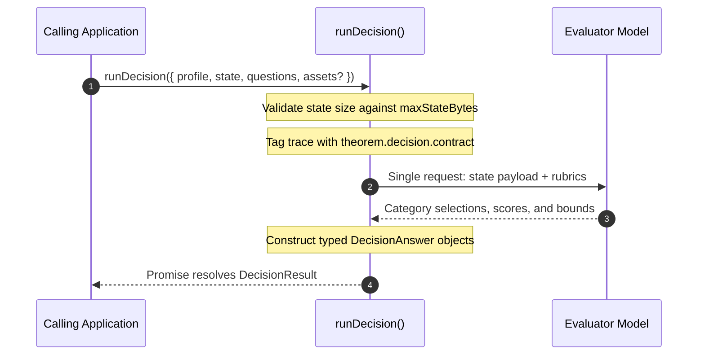
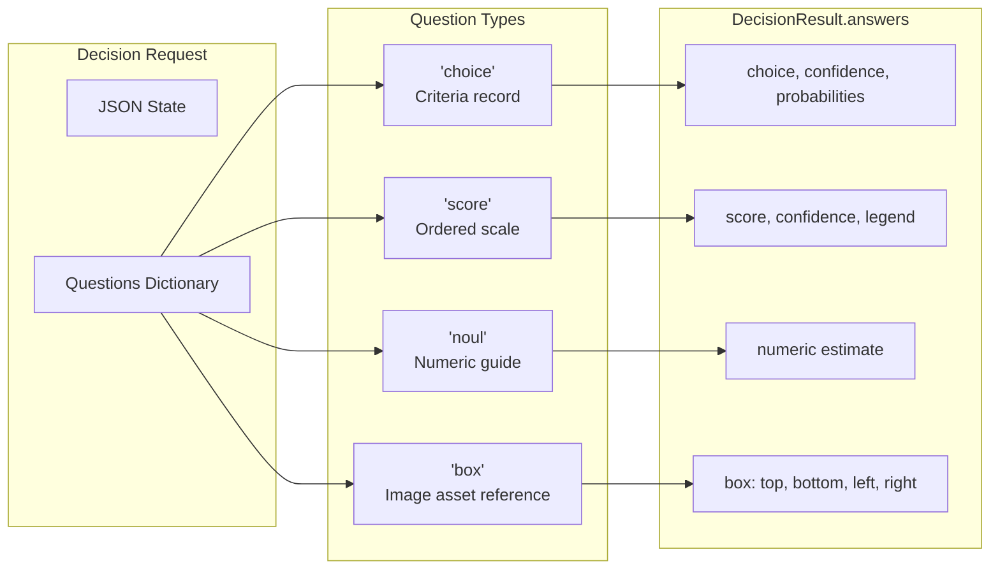

# Decision Profiles & runDecision()

Decision profiles (`type: 'decision'`) configure stateless evaluation agents that judge structured JSON application state against rubric-based questions. They are executed through `runDecision()`, returning deterministic category selections, numerical scores, confidence probabilities, and bounding boxes in a single non-conversational call.

---

## Decision Profile Configuration

Base profile fields (`identity`, `guardrails`, `observability`, `labels`) apply across all modalities as documented in [Profiles](2-1-profiles.md). Unlike conversational text agents or live sessions, decision profiles execute no tool loops, store no conversation history, and require no system prompts. They bind exactly one model and declare state boundaries:

```ts
import { defineProfile } from '@theoremjs/agents';

export const cargoSafetyDecision = defineProfile({
  type: 'decision',
  id: 'harbor.cargo_safety_decision',
  // ... identity, models

  inputs: {
    state: 'json',
    maxStateBytes: 256 * 1024, // 256 KB limit on input JSON state
  },

  decision: {
    // Trace label for telemetry; an identifier string, not a schema definition
    contract: 'cargo_hazard_classification_v1',
  },

  // ... guardrails, observability, labels
});
```

### Architectural Invariants

* **Single Model Rule**: Decision profiles bind exactly one model under `models` (with an optional `timeoutMs`). They do not support `defaultModel` or `allowModelSelect` because decisions evaluate against a single fixed evaluator.
* **No Tools or System Channel**: Decision profiles call no tools. Instructions are delivered strictly through question rubrics, and input data is delivered strictly through `state`.
* **Stateless Execution**: Decisions maintain no conversational history, produce no tokens across turns, and perform no history compaction.

---

## JSON State Inputs & Asset References

A decision evaluates arbitrary structured data provided at call time:



* **`inputs.state: 'json'`**: The payload being evaluated. State can be any valid JSON value (objects, arrays, strings, numbers, booleans).
* **`inputs.maxStateBytes`**: Maximum payload size in bytes. Payloads exceeding this limit are refused before leaving your process.
* **`decision.contract`**: A host-defined trace label. Despite the name `contract`, this field does not define or bind a schema—the question contract is declared at invocation time in `runDecision()`. Theorem records this string on OpenTelemetry spans as `theorem.decision.contract` for trace filtering and auditing.

### Multimodal Asset References

When a decision evaluates images (e.g. photos of cargo containers or inspection tags), callers pass image data in `DecisionRequest.assets` using bracketed references like `<seal_photo>`:

```ts
assets: {
  '<seal_photo>': {
    mimeType: 'image/jpeg',
    data: base64JpegBytes,
  },
}
```

The model reads the image wherever its reference appears in `state` or in a question's instructions. Unreferenced assets are omitted from the request automatically.

---

## Question Contracts & Rubrics

Callers submit one or more structured questions in `DecisionRequest.questions`. Theorem supports 4 question types:



| Question Type | Type Key | Input Specification | Model Output (`DecisionAnswer`) |
| :--- | :--- | :--- | :--- |
| **Categorical Choice** | `'choice'` | `instructions: string`, `criteria: Record<string, string>` | `choice: string`, `confidence: number`, `probabilities: Record<string, number>` |
| **Rubric Scoring** | `'score'` | `instructions: string`, `criteria: string[]` (ordered 0 to $N$) | `score: number`, `confidence: number`, `legend: Record<string, string>`, `probabilities: Record<string, number>` |
| **Numeric Estimate** | `'noul'` | `instructions: string`, optional `criteria` guide | `noul: number` |
| **Image Bounding Box** | `'box'` | `instructions: string`, optional `image` target | `box: { top, bottom, left, right }`, `confidence: number` |

---

## Invoking Decisions: `runDecision()`

Decisions are executed using `runDecision()`. The function returns a `Promise<DecisionResult>` containing the model used, token consumption, and the resolved answer for every question.

### Basic Invocation

```ts
import { runDecision } from '@theoremjs/agents';

const result = await runDecision({
  profile: 'harbor.cargo_safety_decision',
  state: {
    containerId: 'CONT-9941',
    declaredWeightKg: 14200,
    flammable: true,
    sealIntact: true,
  },
  questions: {
    clearanceVerdict: {
      type: 'choice',
      instructions: 'Determine intake disposition based on container state.',
      criteria: {
        clear: 'Safe for immediate yard intake.',
        hold: 'Hold for physical inspection.',
        quarantine: 'Hazardous cargo or compromised seal requiring quarantine.',
      },
    },
    riskScore: {
      type: 'score',
      instructions: 'Score the overall intake risk from lowest to highest.',
      criteria: [
        'Routine non-hazardous cargo.',
        'Heavy non-hazardous cargo.',
        'Flammable cargo with verified intact seal.',
        'Compromised seal or unverified manifest.',
      ],
    },
  },
});

const verdict = result.answers.clearanceVerdict;
if (verdict.type === 'choice') {
  console.log(`Verdict: ${verdict.choice}`);
  console.log(`Confidence: ${verdict.confidence}`);
  console.log('Class probabilities:', verdict.probabilities);
}
```

---

### `DecisionResult` Structure

The returned `DecisionResult` provides typed answers keyed by question ID:

| Field | Type | Description |
| :--- | :--- | :--- |
| **`model`** | `string` | The resolved model ID that performed the evaluation. |
| **`answers`** | `Record<string, DecisionAnswer>` | Map of question IDs to their evaluated answers (`choice`, `score`, `noul`, or `box`). |
| **`usage`** | `object` | Reported usage: `inputTokens`, `outputTokens`, `costUsd`, and `estimated` flag. |

---

## Related Guides

* **[Profiles](2-1-profiles.md)**: Shared identity, registry lifecycle, and profile types.
* **[Model Bindings](2-2-model-bindings.md)**: Vault credentials, protocol definitions, and execution limits.
* **[Text Profiles](2-1-1-text-profiles.md)**: Multi-turn conversational agents with tool execution loops.
