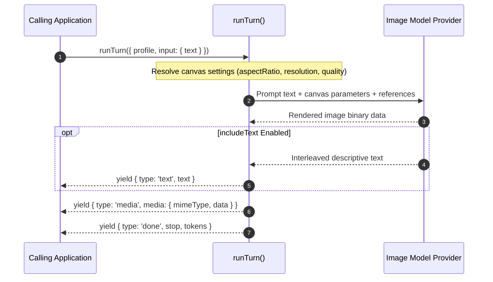

# Image Profiles & Media Generation

Image profiles (`type: 'image'`) configure agents that generate, edit, or transform visual media assets from text prompts. They execute through `runTurn()`, yielding binary media events alongside optional descriptive text.

---

## Image Profile Configuration

Base profile fields (`identity`, `models`, `guardrails`, `observability`, `labels`) apply across all modalities as documented in [Profiles](2-1-profiles.md). Image profiles declare an `image` block specifying canvas dimensions, format, output fidelity, and generation controls:

```ts
import { defineProfile } from '@theoremjs/agents';

export const blueprintIllustrator = defineProfile({
  type: 'image',
  id: 'harbor.blueprint_illustrator',
  // ... identity, models

  image: {
    aspectRatio: '16:9',
    resolution: '2K',
    mimeType: 'image/png',
    quality: 'high',
    background: 'opaque',
    n: 1,
    seed: 42,
    includeText: false, // Set to true to receive interleaved text alongside the image
  },

  // ... guardrails, observability, labels
});
```

---

## Image Generation Settings

The `image` block configures how downstream providers render generated visual assets:



| Setting | Type | Description |
| :--- | :--- | :--- |
| **`aspectRatio`** | `string` | Canvas aspect ratio, such as `'1:1'`, `'16:9'`, `'4:3'`, or `'9:16'`. |
| **`resolution`** | `string` | Output canvas detail tier, such as `'1K'`, `'2K'`, or `'4K'`. |
| **`mimeType`** | `string` | Encoding format for generated assets (`'image/png'`, `'image/jpeg'`, or `'image/webp'`). |
| **`quality`** | `string` | Model rendering effort: `'auto'`, `'low'`, `'medium'`, or `'high'`. |
| **`background`** | `string` | Background composition: `'auto'`, `'transparent'`, or `'opaque'`. |
| **`n`** | `number` | Number of image candidates to generate per request where supported by the provider. |
| **`seed`** | `number` | Deterministic random seed for reproducible image generation where supported. |
| **`outputCompression`** | `number` | Compression quality rating from 0 to 100 for JPEG and WebP outputs. |
| **`references`** | `Array<TurnBlob \| TurnMediaRef>` | Static reference images or brand assets injected before user prompts on every turn. |
| **`includeText`** | `boolean` | When true, instructs the provider to generate interleaved descriptive text alongside image bytes. |

Settings unsupported by the chosen provider are omitted or rejected by provider adapters during startup validation.

---

## Invoking Image Profiles: `runTurn()`

Image profiles are executed using `runTurn()`, following the request patterns established in [Text Profiles](2-1-1-text-profiles.md). Instead of streaming completion text deltas alone, the turn yields `media` events containing base64-encoded image payloads.

### Basic Invocation

```ts
import { runTurn } from '@theoremjs/agents';

const events = runTurn({
  profile: 'harbor.blueprint_illustrator',
  input: {
    text: 'Aerial architectural rendering of a modern deepwater shipping container berth at twilight.',
  },
});

for await (const event of events) {
  if (event.type === 'media') {
    // event.media contains { mimeType: string, data: string } (base64-encoded)
    saveImage(event.media.mimeType, event.media.data);
  }
  if (event.type === 'text') {
    // Emitted only when image.includeText is enabled
    process.stdout.write(event.text);
  }
}
```

---

### Key Image Events

| Event Type | Payload | Description |
| :--- | :--- | :--- |
| **`media`** | `event.media: { mimeType: string, data: string }` | Emitted when image generation finishes, containing the base64-encoded file bytes and MIME type. |
| **`text`** | `event.text: string` | Incremental descriptive text delta, emitted only when `image.includeText: true`. |
| **`done`** | `event.stop: TurnStop`, `event.tokens?: TurnTokens` | Terminal event signaling completion and token consumption. |
| **`error`** | `event.errorKind: ErrorKind`, `event.error?: string` | Emitted if provider generation fails, content safety filters trigger, or network times out. |

---

## Related Guides

* **[Profiles](2-1-profiles.md)**: Universal profile identity, model bindings, inputs, and registry lifecycle.
* **[Text Profiles](2-1-1-text-profiles.md)**: Multi-step conversational agents and complete `runTurn()` mechanics.
* **[Model Bindings](2-2-model-bindings.md)**: Declaring image generation models, credential slots, and timeouts.
