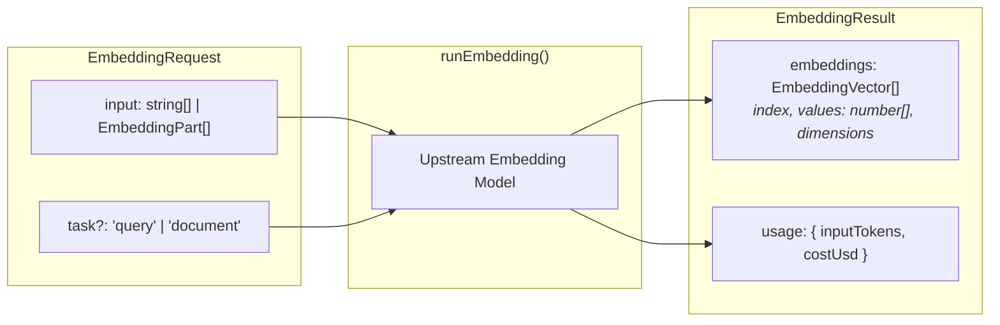

# Embedding Profiles & runEmbedding()

Embedding profiles (`type: 'embedding'`) configure agents that generate dense vector representations of text and media inputs for semantic search, document retrieval, and clustering. They are executed through `runEmbedding()`, returning numerical vector arrays in a single stateless request.

---

## Embedding Profile Configuration

Base profile fields (`identity`, `models`, `guardrails`, `observability`, `labels`) apply across all modalities as documented in [Profiles](2-1-profiles.md). Embedding profiles configure accepted input boundaries and payload caps:

```ts
import { defineProfile } from '@theoremjs/agents';

export const manifestEmbedder = defineProfile({
  type: 'embedding',
  id: 'harbor.manifest_embedder',
  // ... identity, models

  inputs: {
    text: true,
    maxBytes: 64 * 1024, // 64 KB cap per individual input text
  },

  // ... guardrails, observability, labels
});
```

---

## Architectural Invariants

* **No System Prompt**: Embedding profiles accept no system prompt (`identity.system`). The model vectorizes the supplied input directly without instruction framing.
* **No Tool Execution**: Embedding profiles execute no tools and maintain no conversational history or compaction cycles.
* **Multi-Model Routing**: Like text agents, embedding profiles support multiple bound models under `models`, declaring `defaultModel` and `allowModelSelect` to permit callers to specify embedding architectures dynamically.

---

## Embedding Execution Flow

Theorem runs the embedding request directly against the bound model and returns the raw vector coordinates. Theorem owns no database and performs no vector search:



### The `task` Parameter

Some providers (such as Gemini) accept a task type hint when generating vectors:
* **`'document'`**: Hints that the input is a passage to be stored.
* **`'query'`**: Hints that the input is a retrieval query.

Providers that do not differentiate between query and document vectors ignore this setting. Theorem passes the hint through and returns the vector coordinates to your application.

---

## Invoking Embeddings: `runEmbedding()`

Embeddings are generated using `runEmbedding()`. The function accepts batch inputs (strings or multimodal parts) and returns a `Promise<EmbeddingResult>` containing ordered vector arrays.

### Basic Invocation

```ts
import { runEmbedding } from '@theoremjs/agents';

const result = await runEmbedding({
  profile: 'harbor.manifest_embedder',
  input: [
    'Container #CONT-9941 containing industrial pressure valves.',
    'Safety data sheet for class 3 flammable liquid storage.',
  ],
  task: 'document',
});

for (const vec of result.embeddings) {
  console.log(`Index ${vec.index}: ${vec.dimensions} dimensions`);
  console.log('Sample coordinates:', vec.values.slice(0, 3));
}
```

---

### `EmbeddingResult` Structure

The resolved `EmbeddingResult` object returns vector values mapped to the original input order:

| Field | Type | Description |
| :--- | :--- | :--- |
| **`model`** | `string` | The resolved model ID that generated the vectors. |
| **`embeddings`** | `EmbeddingVector[]` | Array of vector objects, each containing `index: number`, `dimensions: number`, and `values: readonly number[]`. |
| **`usage`** | `object` | Provider token counts (`inputTokens`) and associated cost metrics. |

---

## Related Guides

* **[Profiles](2-1-profiles.md)**: Universal profile identity, model bindings, inputs, and registry lifecycle.
* **[Decision Profiles](2-1-3-decision-profiles.md)**: Structured rubric evaluations without conversation history.
* **[Model Bindings](2-2-model-bindings.md)**: Configuring upstream embedding models, providers, and credential slots.
