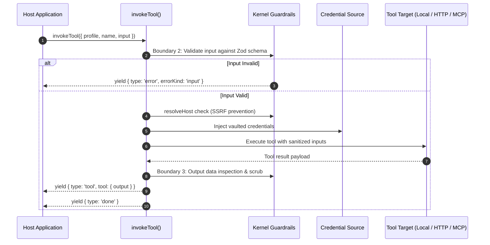

# Host Profiles & invokeTool()

Host profiles (`type: 'host'`) configure governed passthrough runners that execute registered tools directly without an underlying model. They are executed through `invokeTool()`, running local handlers, HTTP endpoints, and Model Context Protocol (MCP) tools under boundary guardrails, parameter schema validation, and credential injection.

---

## Host Profile Configuration

Base profile fields (`guardrails`, `observability`, `labels`) apply across all modalities as documented in [Profiles](2-1-profiles.md). Host profiles omit models and agent personas entirely, declaring only permitted tools and concurrency policies:

```ts
import { defineProfile } from '@theoremjs/agents';

export const toolGateway = defineProfile({
  type: 'host',
  id: 'harbor.tool_gateway',

  tools: {
    allow: ['manifest_lookup', 'weather_radar', 'mcp_customs_query'],
    parallel: true, // Allow concurrent execution when multiple tools run
  },

  // ... guardrails, observability, labels
});
```

---

## Architectural Invariants

* **Model-Less Execution**: Host profiles bind no models (`models` is omitted) and have no persona or instructions (`identity` is omitted). They execute tools directly as requested by the host application.
* **Governed Boundary Enforcement**: Unlike calling a tool function directly, `invokeTool()` routes the call through Theorem's execution lifecycle:
  * **Boundary 2 (Arguments)**: Validates input arguments against the tool's registered Zod schema before execution begins.
  * **Boundary 3 (Results)**: Inspects and sanitizes tool outputs before returning them to callers.
  * **SSRF Protection (`resolveHost`)**: Validates domain names before remote HTTP or MCP requests are dispatched, preventing access to private network addresses.
  * **Credential Injection**: Injects vaulted API keys and OAuth tokens (`ToolCredentialSource`) into tool execution contexts without exposing them to application layers.
* **No Conversational Turns**: Host profiles maintain no dialog history, produce no text tokens, and require no step loops or compaction cycles.



---

## Invoking Tools: `invokeTool()`

Tools under a host profile are executed using `invokeTool()`. The runner returns an async generator yielding typed execution and lifecycle events.

### Basic Invocation

```ts
import { invokeTool } from '@theoremjs/agents';

const events = invokeTool({
  profile: 'harbor.tool_gateway',
  name: 'manifest_lookup',
  input: {
    trackingNumber: 'TRK-88294100',
  },
});

for await (const event of events) {
  if (event.type === 'tool' && 'output' in event.tool) {
    console.log('Manifest result:', event.tool.output);
  }
}
```

Because `invokeTool()` returns an async generator, execution begins when the caller pulls the first event.

---

### Key Invocation Events

| Event Type | Payload | Description |
| :--- | :--- | :--- |
| **`tool`** | `event.tool: ToolCallEvent` | Emitted when tool execution starts (`input`) and when it finishes (`output`). |
| **`guardrail`** | `event.guardrail: GuardrailEvent` | Emitted if an argument detector or egress inspection rule trips. |
| **`done`** | `event.stop: TurnStop` | Terminal event indicating tool completion. |
| **`error`** | `event.errorKind: ErrorKind`, `event.error?: string` | Emitted if parameter validation fails, network resolution is blocked, or the tool throws an unhandled error. |

---

## Related Guides

* **[Profiles](2-1-profiles.md)**: Universal profile identity, inputs, and registry lifecycle.
* **[Defining Tools](3-1-tools.md)**: Declaring parameter schemas, credentials, and handlers for tools.
* **[MCP & Remote Tools](3-1-3-mcp-tools.md)**: Connecting external Model Context Protocol servers and remote HTTP tools.
