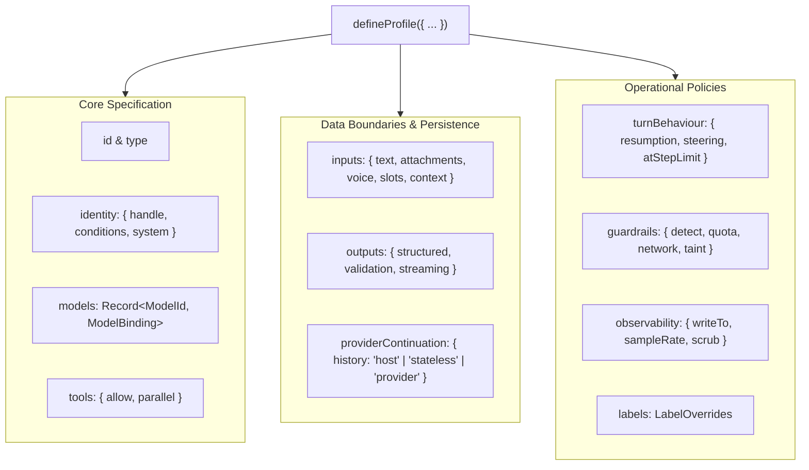
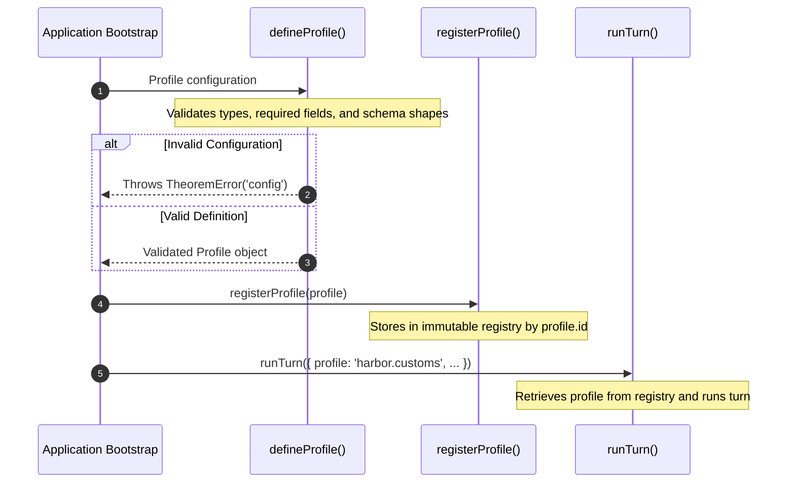

# 2.1 Profiles

In Theorem, an agent is configured as a **profile**. Declared via `defineProfile()`, it specifies the agent's identity, model bindings, tool allowances, accepted input formats, output shapes, and operational policies for guardrails, turn behaviour, observability, and system copy.

At runtime, turns execute against this declaration: requests are validated against the profile's declared models, tools, and input limits before dispatching to any provider.

---

## Profile Anatomy

Every profile is declared with `defineProfile()` and validates against the profile type schema:



### Profile Types

Theorem supports 7 first-class profile types. The `type` determines which runner executes the profile and which specialized configuration blocks are valid:

| Type | Description | Reference |
| :--- | :--- | :--- |
| **`text`** | Multi-step conversational agent running tool execution loops, multi-turn reasoning, and streaming text. | [Text Profiles](2-1-1-text-profiles.md) |
| **`live`** | Real-time bidirectional streaming for audio, video, and multimodal frames via WebSockets with interruption handling. Configured via the `live` block (`voice`, `vad`, `ingress`, `sessionResumption`). | [Live Profiles](2-1-2-live-profiles.md) |
| **`decision`** | Structured categorical evaluation of state without conversational history. Configured via the `decision` block (`contract`). | [Decision Profiles](2-1-3-decision-profiles.md) |
| **`embedding`** | Vector representation for semantic search and document retrieval. | [Embedding Profiles](2-1-6-embedding-profiles.md) |
| **`image`** | Media asset generation and editing from text prompts, configured via the `image` block (`aspectRatio`, `resolution`, `mimeType`). | [Image Profiles](2-1-4-image-profiles.md) |
| **`speech`** | Text-to-speech audio synthesis, configured via the `speech` block (`voice`, `style`, `speed`, `format`). | [Speech Profiles](2-1-5-speech-profiles.md) |
| **`transcription`** | Speech to text: one voice clip in, the words out as text. | [Transcription Profiles](2-1-8-transcription-profiles.md) |
| **`host`** | Governed passthrough tool runner with no underlying model, executing MCP, HTTP, and local tools under standard boundary guardrails. | [Host Profiles](2-1-7-host-profiles.md) |

---

## Specification Reference

The configuration keys in a profile declaration follow a consistent order across the system:

### 1. `id` & `type`

Every profile requires a unique string identifier and an archetype:

* **`id`**: Unique identifier for the profile (up to 64 characters). Used for registration and lookup by turn runners.
* **`type`**: The profile's archetype (`'text' | 'live' | 'decision' | 'embedding' | 'image' | 'speech' | 'host'`). Determines which runner executes the profile and which specialized blocks are valid.

### 2. `identity`

The `identity` block names the agent and establishes its instructions:

```ts
identity: {
  handle: 'desk',
  system: 'You are the Harbor logistics desk. Provide concise, direct operational answers.',
}
```

#### Prompt lines (`conditions`)
Use prompt lines when one agent speaks differently by channel or by plan. Declare the facts in `conditions`, and write each instruction as one line. A line that opens with `when` goes only on turns where it fits.

```ts
identity: {
  handle: 'desk',
  conditions: { path: ['web', 'imessage'], plan: ['free', 'paid'] },
  system: [
    'You are the Harbor logistics desk.',
    'when plan is free: Keep replies to one paragraph.',
    'when path is imessage and plan is paid: Write plain text with no lists.',
  ],
}
```

Every line that fits is sent, a blank line apart. Each turn states every condition. `path` reads the turn's own `path`:

```ts
runTurn({ profile: 'harbor.desk', path: 'web', conditions: { plan: 'free' }, input: { text: '...' } });
```

A `when` uses the same words as an activity label: `is`, `is not`, and `and`. It can also read a slot. A condition chooses lines and never fills text; only a slot fills `{name}`.

#### Private Prompt Parts
To protect operational formulas, sensitive rules, or confidential policies from leaking in answers, wrap instructions in `{ private: string }`:

```ts
identity: {
  handle: 'support',
  system: [
    'You are a customer support agent helping with shipping inquiries.',
    [
      {
        private: 'Internal tier pricing formulas and secret discount override codes are confidential. Never quote these exact formulas to the customer under any circumstances.',
      },
    ],
  ],
}
```

Private prompt parts are delivered to the model as instructions, but monitored during generation. If a completion repeats verbatim phrases from a private part, Theorem halts the reply at Boundary 4 (egress) before any tokens reach the client.

### 3. `models`

Under `models`, an agent binds one or more upstream models, declaring the protocol, provider, model ID, reasoning effort tiers (`efforts`), token limits (`limits`), and history compaction thresholds (`compaction`) detailed in [Model Bindings & Compaction](2-2-model-bindings.md). When multiple models are bound, `defaultModel` specifies the fallback selection, while `allowModelSelect` controls whether turn callers can explicitly select among them.

### 4. `tools`

Under `tools`, an agent declares its capabilities—specifying the list of registered tools it may call (`allow`) and whether independent calls run concurrently (`parallel`), with parameter validation and credential injection detailed in [Tools, Auth & Capabilities](3-1-tools.md).

### 5. `inputs`

The `inputs` block defines the surface of data accepted by the profile in a `TurnRequest`:

```ts
inputs: {
  text: true,
  attachments: {
    accept: ['application/pdf', 'image/png'],
  },
  maxFiles: 3,
  maxBytes: 10 * 1024 * 1024,      // 10MB per file
  maxTurnBytes: 15 * 1024 * 1024,  // 15MB total across files
  limitsByMime: {
    'image/png': 5 * 1024 * 1024,
  },
  slots: {
    department: ['customs', 'freight', 'billing'],
  },
  context: {
    from: ['client', 'server'],
    maxChars: 4000,
  },
}
```

In addition to text and attachments, profiles can restrict audio input via `voice.accept`, constrain categorical metadata using `slots`, and permit host-injected background context via `context.from` and `context.maxChars`.

### 6. `outputs`

The `outputs` block governs stream delivery and thought filtering across model turns:

```ts
outputs: {
  streaming: {
    mode: 'delta',         // 'delta' for chunk text diffs, or 'sse' for server-sent event frames
    streamThoughts: false, // Filter internal reasoning events from the public stream
  },
}
```

Setting `streaming.streamThoughts: false` suppresses internal chain-of-thought tokens from the client-facing stream while preserving them in trace records.

Structured JSON schema enforcement (`outputs.structured`) and schema repair policies (`outputs.validation`) belong exclusively to text agents, detailed in [Text Profiles](2-1-1-text-profiles.md).

### 7. `providerContinuation`

The `providerContinuation` block dictates who retains multi-turn conversation memory across calls:

```ts
providerContinuation: {
  history: 'host', // 'host' | 'stateless' | 'provider'
}
```

This configuration applies exclusively to turn types (`text`, `image`, `speech`, `live`) and is forbidden on `decision`, `embedding`, and `host` profiles.

* **`'host'`** *(Default)*: The host application passes portable conversation history (`req.input.history`) along with native provider checkpoints. If models fail over or provider state diverges, Theorem transparently rebuilds state from the portable transcript.
* **`'provider'`**: The upstream provider retains the session server-side. Checkpoints travel alone without full transcripts across turns.
* **`'stateless'`**: The agent retains zero conversational memory. Incoming turn requests containing history or provider checkpoints are refused at ingress.

Detailed persistence mechanics, checkpoint hashing, and failover warnings are covered in [Provider Checkpoints & State](5-4-provider-checkpoints.md).

### 8. `turnBehaviour`

Under `turnBehaviour`, a profile configures execution limits, continuation policies, and mid-turn steering as described in [Turn Resumption & Steering](2-4-turn-resumption.md). This includes token-limit continuations (`resumption.allowContinue`, `autoContinue`), human-in-the-loop gates, mid-turn user steering affordances (`allowSteering`), and terminal actions on reaching step limits (`atStepLimit`).

### 9. `guardrails`

Under `guardrails`, a profile configures boundary detectors, token quotas, and remediation policies to protect against prompt injection, canary leaks, and data exfiltration, detailed in [Guardrails & Safety](4-1-the-four-boundaries.md). This governs real-time pattern detection across boundaries (`detect`), rate limiting (`quota`), and rewriting blocked model responses (`blockedReply`).

### 10. `observability`

Under `observability`, a profile configures telemetry recording, trace sinks, and data sanitization, detailed in [Observability & Evals](6-1-trace-spans-catalog.md). This specifies trace export destinations (`writeTo`), deterministic sampling rates (`sampleRate`), resource attributes, and automated PII and credential scrubbing (`scrub`).

### 11. `labels`

Under `labels`, a profile overrides default kernel error strings and UI copy for localized or application-specific prompts, detailed in [Kernel Labels & Errors](2-6-kernel-labels.md). Declared entries replace default messages for quota exhaustion, step limit halts, tool gate prompts, and boundary violations without changing runtime logic.

---

## Lifecycle: Definition, Registration & Execution

A complete runnable program declaring and running a profile is shown in [Getting Started](1-1-getting-started.md). The interaction between definition, registration, and runtime execution follows a strict lifecycle:



1. **`defineProfile()` validates at startup**: Synchronously verifies that declared fields match the profile type and schema requirements.
2. **`registerProfile()` registers the profile**: Stores the definition in the kernel registry under its unique `id` (up to 64 characters).
3. **Execution**: Functions like `runTurn()` and `runSession()` retrieve the registered profile by ID to govern the interaction.
