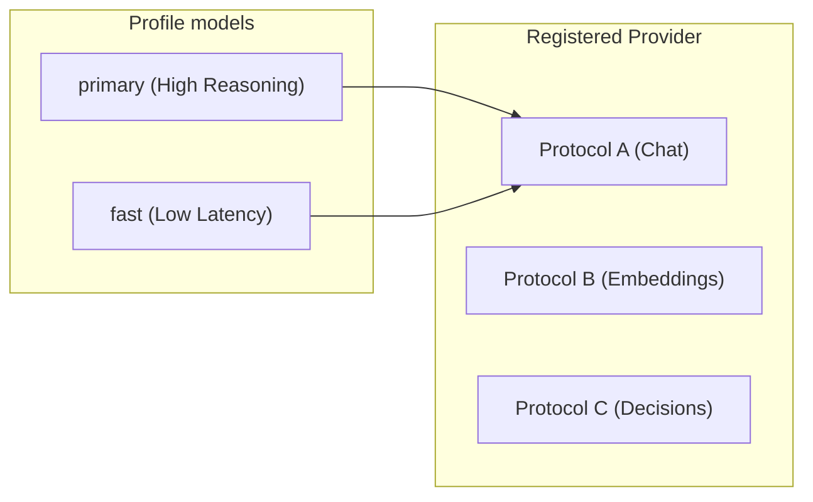

# 2.2 Model Bindings

In Theorem, models are not hardcoded vendor strings. A model is declared as a **binding** that links a local identifier to an upstream protocol, a registered provider, an API model name, and execution budgets.

Because conversation histories grow over multi-turn interactions, model bindings can also declare automated history compaction thresholds, detailed in [History Compaction](2-3-history-compaction.md).

---

## The Model Triad: Protocol, Provider, Binding

Model execution separates into three distinct concepts:

* **Protocol**: The wire format and communication rules for an API shape (such as OpenAI Chat Completions or Google Gemini Interactions). Protocols write outgoing requests and parse incoming stream events.
* **Provider**: A service definition containing endpoint addresses, authentication methods, and the protocols it serves. Providers carry no request-transformation code.
* **Binding**: The profile configuration under `models`. It pairs a registered provider with one of its served protocols and an upstream model ID.

Because providers serve multiple protocols across different modalities—such as chat completions, vector embeddings, and real-time WebSockets—every binding explicitly specifies which protocol that model speaks.



---

## Declaring a Model Binding

Bindings are declared under `models` on the profile:

```ts
models: {
  primary: {
    protocol: 'openRouterOpenAi',
    provider: 'openrouter',
    apiId: 'anthropic/claude-5.5-opus',
    keySlot: 'openrouter',
    maxOutputTokens: 4096,
  },
}
```

Bindings can also be generated using a registered provider's helper:

```ts
import { openRouterProvider, registerProvider } from '@theoremjs/agents';

const router = registerProvider(openRouterProvider, { keySlot: 'openrouter' });

export const primaryModel = router.model('openRouterOpenAi', 'anthropic/claude-5.5-opus', {
  maxOutputTokens: 4096,
});
```

Both forms produce the exact same validated data shape checked by `modelBindingSchema`.

---

## Credential Slots & The Vault

Profiles contain application architecture, not secrets. Model bindings name credential slots rather than raw API keys:

* **`keySlot`**: Names the credential slot used to sign requests. If omitted, the binding defaults to the provider's registered primary slot.
* **`fallbackKeySlot`**: Names a secondary credential slot tried automatically if the primary slot encounters quota limits or rate limiting.

At runtime, credentials are supplied through a **vault** passed to `runTurn()`:

```ts
await runTurn(
  {
    profile: 'harbor.desk',
    input: { text: 'Check container status.' },
  },
  {
    vault: {
      openrouter: process.env.OPENROUTER_API_KEY,
    },
  },
);
```

Vault entries can be raw strings, credential objects, or asynchronous resolver functions that fetch credentials just-in-time.

---

## Multi-Model Routing & Selection

Profiles can bind multiple models for routing between high-capability reasoning and low-latency execution:

```ts
models: {
  primary: {
    protocol: 'openRouterOpenAi',
    provider: 'openrouter',
    apiId: 'anthropic/claude-5.5-opus',
  },
  fast: {
    protocol: 'openRouterOpenAi',
    provider: 'openrouter',
    apiId: 'anthropic/claude-5.5-haiku',
  },
},
defaultModel: 'primary',
allowModelSelect: true,
```

* **`defaultModel`**: Required whenever more than one model is bound. Specifies which model executes turns that omit a `model` parameter.
* **`allowModelSelect`**: When `true`, turn callers can explicitly select among declared keys (`runTurn({ profile: 'harbor.desk', model: 'fast', input: { ... } })`). When `false`, requests specifying a model are rejected with a typed `TheoremError`.

---

## Reasoning Efforts & Thinking

For reasoning models, Theorem provides a unified hierarchy of effort tiers rather than vendor-specific knobs:

```ts
models: {
  reasoning: {
    protocol: 'openRouterOpenAi',
    provider: 'openrouter',
    apiId: 'anthropic/claude-5.5-opus',
    efforts: {
      low: 'low',
      thorough: 'high',
    },
    defaultEffort: 'low',
    allowEffortSelect: true,
    summaries: true,
  },
}
```

* **`efforts`**: Maps custom tier names to kernel thinking levels: `'none' | 'minimal' | 'low' | 'medium' | 'high' | 'xhigh' | 'max'`.
* **`defaultEffort`**: The effort tier used when a request specifies none. Required when multiple efforts are configured.
* **`allowEffortSelect`**: Allows turn requests to select an effort level (`input: { effort: 'thorough' }`).
* **`summaries`**: When `true`, requests thinking process summaries from supported models and retains them in trace telemetry.

---

## Execution Budgets (`limits`)

To protect applications from hanging connections or runaway provider payloads, bindings can set strict byte and time budgets under `limits`:

```ts
models: {
  primary: {
    protocol: 'openRouterOpenAi',
    provider: 'openrouter',
    apiId: 'anthropic/claude-5.5-opus',
    limits: {
      operationTimeoutMs: 30_000,      // Total call timeout
      connectTimeoutMs: 5_000,         // TCP / TLS handshake timeout
      maxWireResponseBytes: 1_000_000, // 1MB response ceiling
      maxStepBytes: 500_000,           // 500KB per generation step
      maxStepEvents: 500,              // Max SSE events per step
      maxPendingToolCalls: 5,          // Cap simultaneous tool invocations
    },
  },
}
```

Any limit omitted defers to the provider's default connection constraints.

---

## Provider Built-in Tools (`builtInTools`)

Native capabilities hosted and executed directly by the upstream provider—such as OpenRouter's `webSearch` or Google Gemini's `googleSearch`—are declared on the model binding under `builtInTools`:

```ts
models: {
  primary: {
    protocol: 'openRouterOpenAi',
    provider: 'openrouter',
    apiId: 'anthropic/claude-5.5-opus',
    builtInTools: ['webSearch'],
  },
}
```

When declared, the protocol maps the tool directly to provider wire parameters (e.g. adding `web_search_options` to OpenRouter payloads). At turn execution, callers can supply runtime arguments via `builtInArgs`:

```ts
await runTurn({
  profile: 'harbor.desk',
  input: { text: 'Find current bunker fuel rates in Rotterdam.' },
  builtInArgs: {
    webSearch: { maxResults: 3 },
  },
});
```

Unlike host tools configured under `tools.allow`, built-in tools require no local handler functions; execution and data retrieval happen entirely upstream.

---

## Suggested Reading

* **[History Compaction](2-3-history-compaction.md)**: Configuring token baseline thresholds, synchronous in-turn compaction, and background host execution.
* **[Text Agents](2-1-1-text-profiles.md)**: How conversational text agents invoke bound models via `runTurn()`.
* **[Protocols & Defining Providers](5-3-supported-protocols.md)**: Implementing custom wire protocols and registering new upstream model providers.
