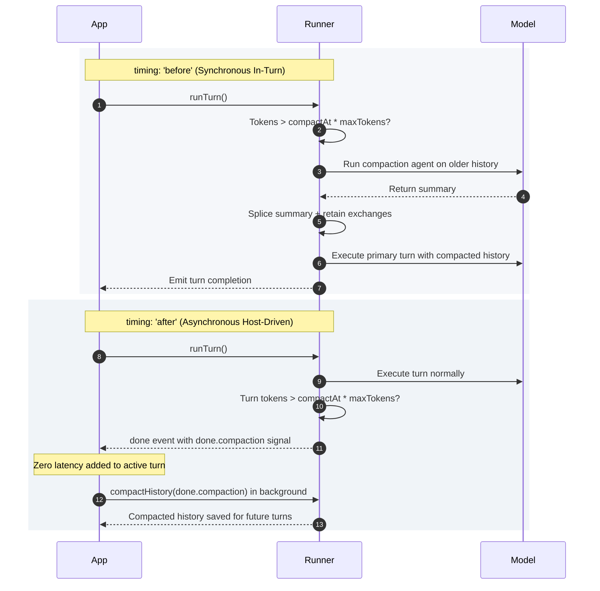

# 2.3 History Compaction

Over long-running conversations, dialogue history consumes substantial token budgets and risks exceeding model context windows. Left unmanaged, long histories degrade model reasoning and increase latency.

In Theorem, **history compaction** automatically condenses older exchanges into a structured summary while preserving recent context verbatim.

---

## The Compaction Specification (`compaction`)

Compaction is configured directly on a profile's model binding:

```ts
models: {
  primary: {
    protocol: 'openRouterOpenAi',
    provider: 'openrouter',
    apiId: 'anthropic/claude-5.5-opus',
    compaction: {
      maxTokens: 32_000,
      compactAt: 0.75,          // Trigger when tokens exceed 24,000 (0.75 * 32,000)
      previousExchanges: 2,     // Retain the last 2 exchanges verbatim
      timing: 'before',         // Run compaction synchronously before the turn
      meter: 'history',         // Measure history messages using token estimator
    },
  },
}
```

### Configuration Parameters

* **`maxTokens`**: The baseline token ceiling against which compaction thresholds are evaluated.
* **`compactAt`**: Fraction of `maxTokens` (between `0` and `1`) that activates compaction. In the example above, compaction fires once tokens exceed 24,000 ($0.75 \times 32,000$).
* **`previousExchanges`**: Governs how much recent dialogue is preserved:
  * `≥ 1` (integer): Preserves the last $N$ user-assistant exchanges intact.
  * `(0, 1)` (fraction): Preserves exchanges that fit within that fraction of `maxTokens`.
  * `0`: Compacts all history; nothing is retained verbatim.
* **`meter`**: Determines how tokens are calculated:
  * `'history'` (default): Estimates tokens across conversation history messages using local estimators.
  * `'input'`: Evaluates total prompt tokens reported upstream by the provider on prior turns.
* **`profile`**: Optional profile ID of a dedicated compaction agent. When omitted, the agent compacts its own history using its base instructions and model, with tools stripped.
* **`trigger`**: Optional custom predicate `(ctx) => boolean | Promise<boolean>` overriding the default token threshold comparison.

---

## Timing: Synchronous vs Asynchronous Compaction

Theorem supports two operational timing models: in-turn synchronous execution, or out-of-band asynchronous execution.



### 1. Synchronous (`timing: 'before'`)

The kernel evaluates token counts before calling the model. If compaction is needed, it runs the compactor immediately, splices the summary into the history, and executes the turn against the fresh history.

The active turn absorbs the compactor's execution latency, but the context is guaranteed to stay within limits before the model is called. During execution, Theorem emits a `compaction` lifecycle event containing the split details and the generated summary.

### 2. Asynchronous (`timing: 'after'`)

The turn executes immediately without added latency. At the conclusion of the turn, the kernel checks whether compaction thresholds were crossed. If so, it attaches a compaction signal to the `done` event (`event.done.compaction`).

The host application reads this signal and triggers out-of-band compaction in the background:

```ts
import { compactHistory } from '@theoremjs/agents';

// Inside your turn event consumer
if (doneEvent.compaction) {
  const result = await compactHistory({
    profile: 'harbor.desk',
    history: currentHistory,
    tokens: doneEvent.compaction.tokens,
  });

  if (result.outcome === 'compacted') {
    // Persist result.history for subsequent turns
    await saveSessionHistory(sessionId, result.history);
  }
}
```

This model is ideal for user-facing applications where response latency is critical, shifting summarization work to background tasks between turns.

---

## Compaction Mechanics & Fault Tolerance

Compaction operates with deterministic rules to prevent data loss or context overflow:

1. **Exchange Splitting**: `splitForCompaction` divides messages into `toCompact` (older) and `toRetain` (recent).
2. **Tool Call Sanitization**: In `toCompact`, tool invocations and results are converted into plain text messages. The compaction agent requires no tool declarations to summarize past actions.
3. **Summary Injection**: The resulting text summary is prepended to `toRetain` with `metadata: { compactionSummary: true }`.
4. **Resilient Failure Handling**:
   * If a compactor fails and current tokens are **under `maxTokens`**, the history remains uncompacted (`outcome: 'deferred'`) so subsequent turns can reattempt compaction.
   * If tokens **exceed `maxTokens`**, `toCompact` is dropped entirely (`outcome: 'dropped'`) to ensure the primary turn does not crash on upstream context length limits.

---

## Suggested Reading

* **[Model Bindings](2-2-model-bindings.md)**: Binding upstream models, protocols, providers, and execution budgets.
* **[Text Agents](2-1-1-text-profiles.md)**: Invoking conversational agents via `runTurn()` and handling stream events.
* **[Turn Resumption & Steering](2-4-turn-resumption.md)**: Managing human-in-the-loop gates, auto-continuations, and mid-turn steering affordances.
