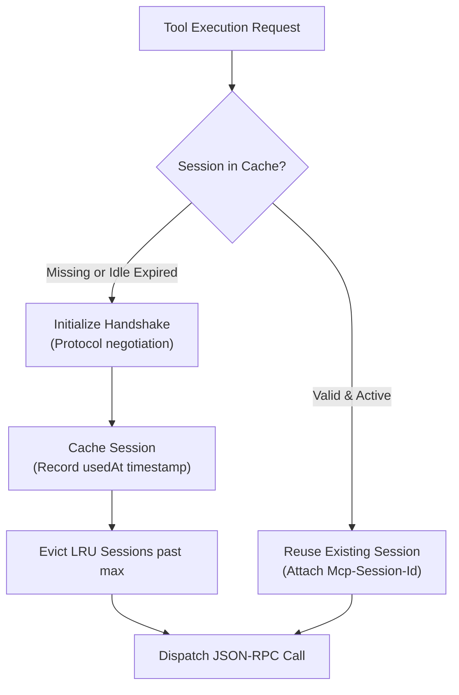

# MCP Tools

Model Context Protocol (MCP) servers expose tools and enterprise resources through a standardized JSON-RPC protocol. An `mcp` tool connects Theorem directly to a remote MCP server URL.

Theorem manages the entire MCP connection and session machine natively in the kernel—handling capability negotiation, session pooling, and reconnection without requiring custom connection wrappers or subprocess supervisors.

---

## Registering an MCP Tool

Register MCP tools using `registerTool()` with `type: 'mcp'`:

```ts
import { registerTool } from '@theoremjs/agents';
import { z } from 'zod';

export const webSearchMcpTool = registerTool({
  type: 'mcp',
  name: 'search_maritime_news',
  description: 'Search maritime trade publications and coastal news feeds.',
  category: 'research',
  access: 'read-only',
  paths: ['*'],
  loadTier: 'T0',
  permission: 'auto',

  serverUrl: 'https://mcp.search.example/sse',
  mcpToolName: 'web_search_news',

  session: {
    idleMs: 120_000, // Keep sessions alive for up to 2 minutes of inactivity
    max: 5,          // Pool up to 5 concurrent sessions
  },

  maxResponseBytes: 2 * 1024 * 1024, // 2 MiB payload cap

  input: z.object({ query: z.string() }),
  output: z.object({
    results: z.array(z.object({ title: z.string(), url: z.string(), snippet: z.string() })),
  }),
});
```

* **`serverUrl`**: The HTTP or Server-Sent Events (SSE) endpoint of the MCP server.
* **`mcpToolName`**: The identifier of the specific tool as registered on the MCP server. The model only sees your tool's `name`, `description`, and `input` schema.
* **`session`**: Declares pooling and idle limits for native session lifecycle management.

---

## Native MCP Session Machine

Connecting to an MCP server requires an initialization handshake where client and server negotiate protocol versions and capabilities before an `Mcp-Session-Id` is established. Re-initiating this handshake on every tool call introduces significant latency.

Theorem manages MCP sessions in kernel memory without external state stores:



### Key Session Capabilities

* **Idle Expiration (`idleMs`)**: When configured, Theorem checks session age on every call. If a session sits unused longer than `idleMs`, it is dropped, and a fresh initialization handshake runs transparently.
* **LRU Connection Pooling (`max`)**: The kernel tracks sessions in least-recently-used order. When active connections for a tool exceed `max`, the oldest idle session is evicted.
* **Parallel Handshake Deduplication**: When multiple model steps or parallel tool calls request the same MCP server simultaneously, Theorem consolidates them into a single in-flight connection handshake. Subsequent callers await the same handshake rather than opening redundant connections.
* **Credential Isolation**: Session cache keys are derived from a hash of the server URL and authorization headers. Different users or auth tokens never share or collide in the session cache.
* **Transparent Recovery**: If an MCP server returns an error indicating that a session expired, Theorem evicts the stale session ID and automatically retries the operation with a fresh handshake.

---

## Transports & Response Protection

Theorem supports both Server-Sent Events (SSE) and direct HTTP POST JSON-RPC transports.

* **Payload Capping**: Set `maxResponseBytes` to cap the maximum response body size (default: 4 MiB). If a server returns an oversized payload, Theorem terminates the stream and fails the call as `response_too_large`.
* **Authenticated MCP Servers**: Pass an `auth` block (see [Auth & Credentials](3-3-auth-credentials.md)) to attach OAuth tokens or API keys to the MCP handshake and tool calls.
* **Multimodal Pictures**: Configure the `images` hook to fetch and deliver image URLs returned by the MCP tool as multimodal parts to the model.

---

## Related Guides

* **[Tools & Execution Pipeline](3-1-tools.md)**: Universal tool attributes, pipeline stages, and dynamic loading.
* **[HTTP Tools](3-1-2-http-tools.md)**: Calling standard REST endpoints.
* **[Agent Tools](3-1-4-agent-tools.md)**: Delegating tasks to other registered agents.
* **[Auth & Credentials](3-3-auth-credentials.md)**: Authenticating MCP tools with OAuth or bearer tokens.
