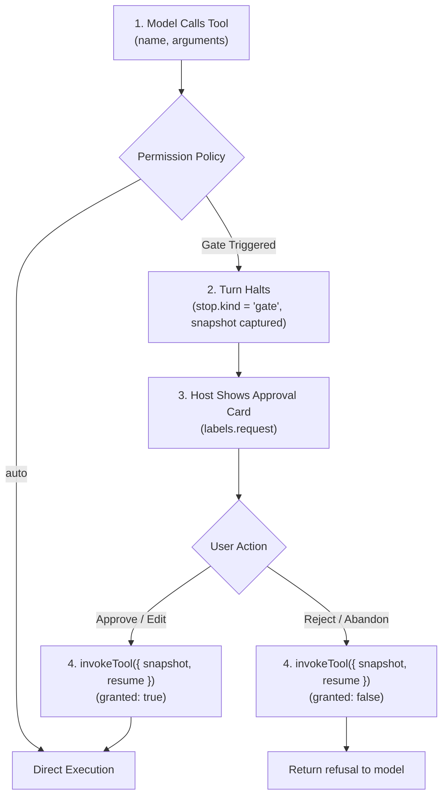

# Tool Permissions & Gates

Model tool calls are requests, not commitments. When an agent attempts an irreversible action—such as transferring funds, releasing cargo holds, or deleting database records—Theorem halts execution before the tool runs and waits for explicit approval.

A held tool call is a **gate**. The turn pauses with `stop: { kind: 'gate' }`, preserves the pending call in a `TurnToolSnapshot`, and lets your frontend present an approval prompt to the user before resuming.

---

## Gate Lifecycle

The gate lifecycle decouples model generation from tool execution:



1. **Gate Trigger**: When a tool requires approval, the kernel suppresses execution.
2. **Turn Halt**: The turn finishes with `stop.kind: 'gate'`. The terminal `done` event provides `done.tools: TurnToolSnapshot` containing the call ID, tool name, and parsed arguments.
3. **User Decision**: The host UI presents the action using the tool's `labels.request` template (e.g., `release hold on {shipmentId}`).
4. **Resumption**: The host passes the snapshot and an `InvokeToolResume` directive to `invokeTool()`, executing the tool or reporting a refusal back to the model.

---

## Permission Policies

Set `permission` on a tool definition to declare its baseline gate policy:

```ts
import { registerTool } from '@theoremjs/agents';

registerTool({
  type: 'function',
  name: 'release_hold',
  // ... access, loadTier, input, output

  permission: 'always_confirm',
  labels: {
    request: 'release the hold on container {containerId}',
  },

  handler: async (input) => {
    // Executes only after user approval
    return { success: true };
  },
});
```

* **`'auto'`**: The tool runs immediately without pausing for confirmation.
* **`'session_consent'`**: The tool pauses for confirmation on first use. Once approved, the host passes the tool ID in `sessionPermissions: ['release_hold']` on subsequent turns; while present, future calls execute without prompting.
* **`'always_confirm'`**: The tool pauses for confirmation before every single execution, regardless of session history.

---

## Gate Kinds

The kernel categorizes held calls into four distinct gate kinds (`ToolGateKind`):

| Gate Kind | Trigger Condition | Resumption Mechanism |
| :--- | :--- | :--- |
| **`'confirmation'`** | Tool has `permission: 'always_confirm'` or was escalated dynamically. | User confirms or denies the action. |
| **`'permission'`** | Tool has `permission: 'session_consent'` and is absent from `sessionPermissions`. | User grants session consent. |
| **`'auth'`** | Remote tool credential is missing or expired (`onUnauthenticated: 'gate'`). | User signs in via OAuth or provides credentials. |
| **`'page'`** | Tool declares `answeredBy: 'page'`. | Web browser client executes action and returns result. |

While `confirmation`, `permission`, and `auth` gates pause for an explicit human decision or credential, a `page` gate is an automated execution pause: the model called an `answeredBy: 'page'` browser tool, and the turn waits for the client web page to return the DOM or client-side result.

---

## Resuming Held Calls (`invokeTool`)

When the user approves or rejects an action, call `invokeTool()` with the preserved `TurnToolSnapshot` and an `InvokeToolResume` descriptor.

### Approving Execution

To approve the call as proposed by the model:

```ts
import { invokeTool } from '@theoremjs/agents';

const resumeEvents = invokeTool({
  profile: 'harbor.desk',
  name: 'release_hold',
  snapshot: doneEvent.tools,
  resume: { granted: true },
  input: doneEvent.tools.calls[0].input,
});

for await (const event of resumeEvents) {
  // Yields standard tool events up to complete
}
```

### Modifying Arguments Before Approval

Users can edit proposed arguments before approving (e.g., adjusting quantities or correcting typos). Pass `resume.edited` with the original input:

```ts
const resumeEvents = invokeTool({
  profile: 'harbor.desk',
  name: 'release_hold',
  snapshot: doneEvent.tools,
  resume: {
    granted: true,
    edited: { from: doneEvent.tools.calls[0].input as Record<string, unknown> },
  },
  input: { containerId: 'CONT-9942' }, // User-edited argument
});
```

The kernel re-validates the edited input against the tool's Zod schema before invoking the handler.

### Rejecting or Abandoning Calls

To decline an action, pass `granted: false`. The kernel settles the tool call as an intentional refusal, formats the explanation, and returns it to the model:

```ts
const refuseEvents = invokeTool({
  profile: 'harbor.desk',
  name: 'release_hold',
  snapshot: doneEvent.tools,
  resume: {
    granted: false,
    cause: 'declined', // 'declined' | 'abandoned' | 'expired'
  },
  input: doneEvent.tools.calls[0].input,
});
```

* **`'declined'`**: The user actively refused the prompt (emits an explicit user refusal note to the model).
* **`'abandoned'`**: The user closed the window or navigated away (settles as cancelled).
* **`'expired'`**: The interaction timed out before an answer was received.

### Answering Page Gates

When a turn halts at a `page` gate, the action requires no user confirmation. The frontend web application executes the browser action directly (such as querying the DOM or inspecting canvas state) and submits the result by calling `invokeTool()` with `page: PageAnswer`:

```ts
import { invokeTool } from '@theoremjs/agents';

const resumeEvents = invokeTool({
  profile: 'harbor.desk',
  name: 'read_viewport_selection',
  snapshot: doneEvent.tools,
  input: doneEvent.tools.calls[0].input,
  page: {
    output: { selectedIds: ['node-44', 'node-89'] },
  },
});
```

The `PageAnswer` payload supports three outcome variants:

* **`{ output: unknown }`**: Successful execution. The kernel validates the returned data against the tool's Zod `output` schema before serializing it for the model.
* **`{ timedOut: true }`**: The client stopped waiting for the browser operation. The kernel settles the call with a `tool.page_timed_out` failure for the model.
* **`{ unanswered: true }`**: The client web page does not implement a handler for the tool. The kernel settles the call with a `tool.page_no_answer` failure for the model.

In live streaming sessions where an active tool execution coordinator (`ctx.pageExecution`) is mounted, the kernel dispatches the call directly across the active connection and awaits `dispatch.result` without pausing at a turn gate.

---

## Dynamic Gate Escalation

A tool configured with `permission: 'auto'` can escalate dynamically to require human approval based on runtime arguments or host state.

### Tool `preTool` Hook

Declare a `preTool` hook on the tool definition to inspect inputs before execution:

```ts
registerTool({
  type: 'function',
  name: 'issue_refund',
  // ... input, output, handler
  permission: 'auto',

  preTool: async (input) => {
    if (input.amount > 500) {
      return {
        confirm: { summary: `Authorize large refund of $${input.amount}?` },
      };
    }
  },
});
```

### Turn `onStage` Interception

Alternatively, the host application can escalate tools dynamically during turn execution using `onStage` at the `'pre_tool'` stage (see [Lifecycle Hooks & Interception](2-5-lifecycle-hooks.md)):

```ts
// ... inside onStage callback
if (ctx.stage === 'pre_tool' && ctx.tool === 'delete_record') {
  return { confirm: { summary: 'Permanently remove database record?' } };
}
```

---

## Related Guides

* **[Tools & Execution Pipeline](3-1-tools.md)**: Declaring schemas, handlers, and core attributes.
* **[Auth & Credentials](3-3-auth-credentials.md)**: Handling OAuth sign-in gates and `auth` credentials.
* **[Liquid Tool Labels](3-4-liquid-labels.md)**: Formatting approval text with the `labels.request` template.
* **[Turn Resumption & Steering](2-4-turn-resumption.md)**: Continuing conversational turns after early stops.
