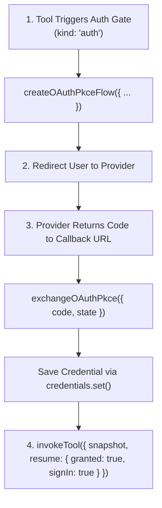

# OAuth PKCE Flow

Theorem includes native helpers for OAuth 2.0 with Proof Key for Code Exchange (PKCE, RFC 7636). Host applications can manage user authorizations without third-party OAuth libraries or session database tables.

The OAuth lifecycle operates through three stages: initiating the flow during a turn, exchanging the authorization code on a callback route, and resuming the held tool call.



---

## 1. Initiate PKCE Flow

When a turn halts on an auth gate (`kind: 'auth'`), initiate the authorization request using `createOAuthPkceFlow()`:

```ts
import { createOAuthPkceFlow } from '@theoremjs/agents';

const flow = await createOAuthPkceFlow({
  resourceServerUrl: 'https://api.tracker.example',
  clientId: 'https://app.example/oauth/client.json',
  redirectUri: 'https://app.example/oauth/callback',
  scopes: gateEvent.tool.gate.authChallenge.requiredScopes,
  signingSecret: process.env.OAUTH_STATE_SECRET!,
  sessionBinding: userSessionId,
});

// Redirect browser to authorization provider
redirect(flow.authorizationUrl);
```

### Security Parameters

* **`signingSecret`**: A secret key of 32 bytes or more maintained on your server. Theorem encrypts the PKCE code verifier and state parameters into the OAuth `state` string. This allows your callback route to verify and complete the exchange without storing pending flow state in a database.
* **`sessionBinding`**: A unique identifier tied to the user's active browser session. Theorem verifies that the callback originates from the identical session that started the authorization, preventing session-fixation attacks.
* **`resourceServerUrl`**: The target service origin (RFC 8707). Theorem binds the issued token to this resource server so it cannot be forwarded to unintended hosts.

---

## 2. Exchange Authorization Code

On your callback endpoint, exchange the authorization code for tokens using `exchangeOAuthPkce()` and persist the credential:

```ts
import { exchangeOAuthPkce } from '@theoremjs/agents';

const { credential } = await exchangeOAuthPkce({
  code: callbackParams.get('code')!,
  state: callbackParams.get('state')!,
  iss: callbackParams.get('iss') ?? undefined,
  redirectUri: 'https://app.example/oauth/callback',
  signingSecret: process.env.OAUTH_STATE_SECRET!,
  sessionBinding: userSessionId,
  clientSecret: process.env.OAUTH_CLIENT_SECRET, // Optional for confidential clients
});

// Save credential into your application's credential store
await userCredentials.set('tracker', credential);
```

Theorem performs five automated security validations during code exchange:
1. **Session Match**: Refuses callbacks whose decrypted session binding does not match `userSessionId`.
2. **Issuer Verification**: Enforces RFC 9207 `iss` matching to prevent authorization mix-up attacks.
3. **Scope Enforcement**: Refuses tokens that include scopes exceeding those requested.
4. **Token Audience**: Verifies that tokens are issued specifically for the target resource.
5. **Redirect Integrity**: Prohibits following redirects during token requests.

---

## 3. Resume the Held Tool Call

With the credential persisted in your `ToolCredentialSource`, resume the gated tool call using `invokeTool()`:

```ts
import { invokeTool } from '@theoremjs/agents';

const resumeEvents = invokeTool({
  profile: 'harbor.desk',
  name: 'list_user_shipments',
  snapshot: gateEvent.tools,
  resume: {
    granted: true,
    signIn: true,
  },
  credentials: userCredentials,
  input: {},
});
```

* Setting `signIn: true` notifies the model that authentication succeeded before returning the tool result.
* If sign-in was cancelled or declined, pass `granted: false` with `signIn: true` and `cause: 'declined'`.

---

## Automatic Token Refresh

OAuth access tokens expire. When a tool with an OAuth credential executes, Theorem checks the token's expiration:

* If the access token is within 30 seconds of its expiry and a `refreshToken` is present, Theorem automatically exchanges the refresh token before executing the tool call.
* The kernel saves the newly issued tokens to your `credentials` source via `credentials.set()` before dispatching the request.
* Multiple concurrent calls sharing the same credential slot consolidate into a single token refresh request.

---

## Related Guides

* **[Auth & Credentials](3-3-auth-credentials.md)**: Credential isolation, tool `auth` configuration, and `ToolCredentialSource`.
* **[Tool Permissions & Gates](3-2-tool-gates.md)**: Gate lifecycle and `invokeTool()` resumption mechanics.
* **[Tools & Execution Pipeline](3-1-tools.md)**: Registering function, HTTP, and MCP tools.
