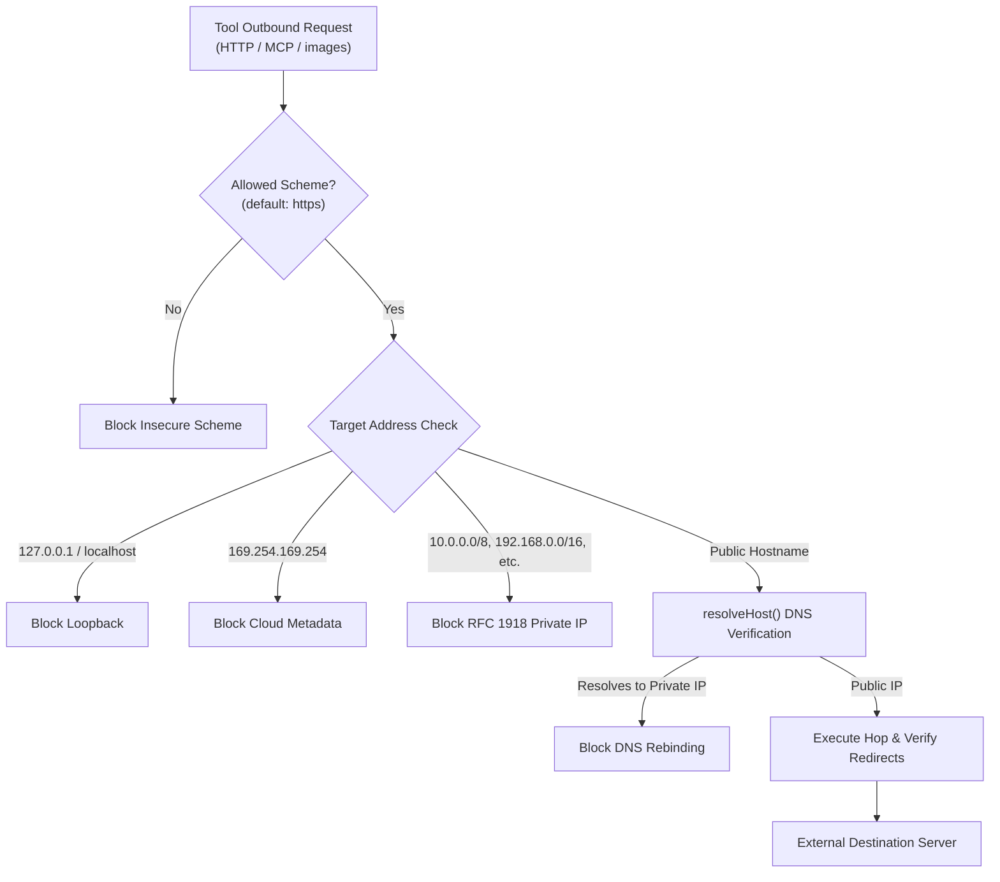

# Network Safety & SSRF

When agents execute outbound HTTP requests or connect to remote MCP servers, they operate in an untrusted network environment. Malicious content or indirect prompt injections can attempt to steer tools into making requests to internal infrastructure, private microservices, or cloud instance metadata endpoints (Server-Side Request Forgery, or SSRF).

Theorem provides deterministic network guardrails configured in `profile.guardrails.network`. These enforce socket-level IP address restrictions, inspect redirect hops, prevent DNS rebinding, and strip credentials when requests cross origins.

---

## Network Isolation Architecture

Theorem intercepts all outbound network requests at the kernel socket boundary before any connection is opened:



---

## Default Network Restrictions

Theorem applies strict network isolation to outbound tool calls by default:

* **Loopback Addresses**: `127.0.0.0/8`, `localhost`, and IPv6 `::1` are blocked.
* **Cloud Instance Metadata**: Link-local address `169.254.0.0/16` (including `169.254.169.254` used by AWS, Google Cloud, and Azure for instance identity credentials) is blocked.
* **RFC 1918 Private Subnets**: `10.0.0.0/8`, `172.16.0.0/12`, and `192.168.0.0/16` are blocked.
* **Carrier-Grade NAT & Test Networks**: `100.64.0.0/10` and documentation subnets (`192.0.2.0/24`, `198.51.100.0/24`, `203.0.113.0/24`) are blocked.
* **IPv6 Private & Site-Local**: Unique Local Addresses (`fc00::/7`), Link-Local (`fe80::/10`), and IPv4-mapped private addresses (e.g., `::ffff:10.0.0.1`) are blocked.
* **Allowed Schemes**: Only `https:` URLs are permitted by default. Insecure `http:` is refused unless explicitly enabled.

---

## Hop-by-Hop Redirect Verification

Standard HTTP client libraries follow redirects automatically. Attackers exploit this by hosting a benign public URL that returns an HTTP 302 redirect targeting an internal metadata endpoint or internal network service.

Theorem verifies every redirect hop:
1. **Hop Validation**: Each intermediate redirect (status 301, 302, 303, 307, 308) is evaluated against the network safety policy before the next hop is requested.
2. **Origin-Locked Credentials**: Authentication credentials and authorization headers (`Authorization`, `X-API-Key`) are bound strictly to the initial request's origin. If a redirect targets a different domain, Theorem strips the credentials immediately to prevent token harvesting.
3. **Redirect Limit**: Caps redirects at a hard limit (20 hops) to prevent denial-of-service through redirect loops.

---

## DNS Rebinding Defense (`resolveHost`)

Attackers can configure public domain names whose DNS records resolve to internal IP addresses (e.g., pointing `attacker.example` to `127.0.0.1` or `169.254.169.254`).

To prevent DNS rebinding attacks, provide a `resolveHost` resolver:

```ts
// ... inside host runTurn or fetch options
resolveHost: async (hostname) => {
  const records = await dns.promises.resolve(hostname);
  return records;
},
```

Before dispatching an outbound request to a public hostname, Theorem resolves its IP addresses using your resolver. If any resolved IP address belongs to a private, loopback, or blocked subnet, the request is refused before socket initialization.

---

## Configuring Network Guardrails

Network restrictions are configured on an agent profile in `profile.guardrails.network`:

```ts
import { defineProfile } from '@theoremjs/agents';

export const enterpriseAgent = defineProfile({
  type: 'text',
  id: 'harbor.ops',
  // ... identity, models, tools

  guardrails: {
    network: {
      allowPrivateNetworks: false, // Set to true only in local development or CI
      allowedHosts: ['api.github.com', 'internal-gateway.corp.example'], // Host allowlist
      allowedSchemes: ['https'], // Restrict to secure transports
    },
  },
});
```

* **`allowPrivateNetworks`**: Permits connections to localhost and private subnets (useful for local development and integration test suites). Defaults to `false`.
* **`allowedHosts`**: Hostnames exempt from private subnet blocking (such as an internal corporate proxy or gateway).
* **`allowedSchemes`**: Array of permitted URL protocols. Defaults to `['https']` (or `['http', 'https']` when `allowPrivateNetworks` is `true`).

---

## Related Guides

* **[The Four Boundaries](4-1-the-four-boundaries.md)**: Universal boundary model and detector action taxonomy.
* **[Ingress Protection & Taint Tracking](4-2-ingress-protection.md)**: Handling prompt injection and confused-deputy attacks.
* **[Egress Defense & Canaries](4-3-egress-canaries.md)**: Planting canary tokens and stopping zero-click image exfiltration.
* **[Auth & Credentials](3-3-auth-credentials.md)**: Managing credentials with `signedInFetch` and OAuth PKCE.
