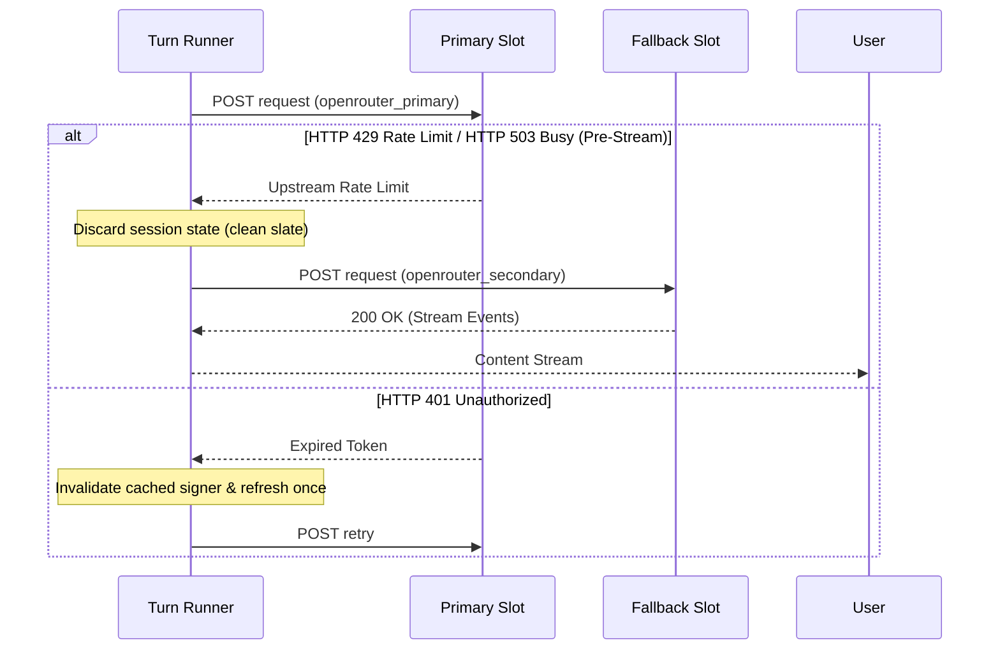

# Model Bindings & Key Slots

A model binding connects a profile to an upstream AI model. It pairs a registered provider with one of its served protocols, an upstream model ID, and credential slots.

Model bindings contain pure configuration. They hold no secret keys, open no sockets, and remain decoupled from environment variables. All credentials stay in the host vault and resolve when a turn runs.

---

## Declaring a Model Binding

Models are declared under `models` on the profile. A binding defines five core fields:

| Field | Type | Description |
| :--- | :--- | :--- |
| **`provider`** | `string` | The ID of a registered provider (e.g., `'openrouter'`, `'gemini'`, `'local'`). |
| **`protocol`** | `string` | The protocol ID served by that provider (e.g., `'openRouterOpenAi'`, `'geminiInteractions'`). |
| **`apiId`** | `string` | Upstream model identifier recognized by the provider (e.g., `'anthropic/claude-3.5-sonnet'`). |
| **`keySlot`** | `string` *(optional)* | Vault credential slot name. Defaults to the provider's registered `keySlot`. |
| **`fallbackKeySlot`** | `string` *(optional)* | Secondary vault slot tried when the primary key hits quota or rate limits. |

```ts
import { defineProfile } from '@theoremjs/agents';

export const harborDesk = defineProfile({
  id: 'harbor.desk',
  type: 'text',
  models: {
    primary: {
      provider: 'openrouter',
      protocol: 'openRouterOpenAi',
      apiId: 'anthropic/claude-3.5-sonnet',
      keySlot: 'openrouter_primary',
      fallbackKeySlot: 'openrouter_secondary',
    },
  },
  // ...
});
```

Bindings can also be generated using a registered provider's helper:

```ts
const primary = router.model('openRouterOpenAi', 'anthropic/claude-3.5-sonnet', {
  fallbackKeySlot: 'openrouter_secondary',
});
```

Both forms produce the exact same validated data object checked by `modelBindingSchema`.

---

## Startup Verification

When `registerProfile()` loads a profile, Theorem validates every model binding synchronously before any network calls occur:

1. **Provider Check**: Confirms the provider ID exists in the active registry.
2. **Protocol Check**: Confirms the registered provider serves `binding.protocol`.
3. **Modality Check**: Confirms the protocol supports the profile's modality (text, live voice, embeddings, images, speech, or decisions).
4. **Options Validation**: Parses `models.*.options` through the protocol's Zod validator.
5. **Slot Invariants**: Ensures `keySlot` does not equal `fallbackKeySlot`, and rejects key slots if the provider definition requires no key.

Any mismatch throws a typed `TheoremError('config')` or `TheoremError('unsupported')` immediately.

---

## Key Slots & Resolution Hierarchy

Credentials never live in profile files. Model bindings point to **slots** in the host vault.

### Slot Name Rules

Slot names must match `KEY_SLOT_NAME`:

```regex
/^[A-Za-z0-9][A-Za-z0-9_-]{0,31}$/
```

Slot names can contain letters, numbers, hyphens, and underscores, up to 32 characters, starting with an alphanumeric character.

### Resolution Hierarchy

Key slots resolve with a clear priority:

* **Binding Override**: If `keySlot` is specified on the model binding, it takes precedence.
* **Provider Default**: If omitted on the model binding, it falls back to the provider's registered `keySlot`.
* **Duplicate Prevention**: `keySlot` and `fallbackKeySlot` cannot match. Setting both to the same slot throws a `TheoremError('config')`.

---

## The Host Vault & Dynamic Resolvers

Vault credentials are provided to `runTurn()` via `options.vault`:

```ts
import { runTurn } from '@theoremjs/agents';

await runTurn(
  { profile: 'harbor.desk', input: { text: 'Summarize manifests.' } },
  {
    vault: {
      openrouter_primary: process.env.OPENROUTER_PRIMARY_KEY,
      openrouter_secondary: process.env.OPENROUTER_BACKUP_KEY,
    },
  },
);
```

### Dynamic Resolvers (`CredentialResolver`)

For rotating credentials, KMS lookups, or secrets fetched just-in-time, pass an async resolver function:

```ts
import { runTurn, type CredentialContext, type KeyCredential } from '@theoremjs/agents';

const getSecretKey = async (ctx: CredentialContext): Promise<KeyCredential> => {
  // ctx contains: providerId, apiId, keySlot, and signal
  return await kmsClient.fetchSecret(ctx.keySlot, { signal: ctx.signal });
};

await runTurn(
  { profile: 'harbor.desk', input: { text: 'Summarize manifests.' } },
  {
    vault: { openrouter_primary: getSecretKey },
  },
);
```

The kernel invokes the resolver only for the slot requested by the active model call.

---

## Automated Failover & Retry

During upstream model execution, Theorem wraps provider requests in an automated self-healing loop:



### Failover Rules

1. **Pre-Stream Trigger**: Automatic failover triggers only on `rate_limit` (HTTP 429) or `busy` (upstream capacity 503) errors that occur before the model stream begins emitting tokens to the client. If a stream has already emitted tokens, failover is aborted and the error propagates to avoid interleaving broken partial output.
2. **Clean Slate Execution**: When switching to `fallbackKeySlot`, the request runs with a clean session state. Cached prompt states, interaction IDs, and session continuation headers from the primary key are discarded because the fallback slot may belong to an entirely different tenant or billing account.
3. **Telemetry Row**: Each failover records an upstream `key_fallback` trace event containing the source slot, destination slot, error kind, and timestamp.
4. **Auth Invalidation**: When an upstream call returns an HTTP 401 unauthorized error, the kernel invalidates the cached signer token and attempts one refresh retry.

---

## Related Guides

* **[Defining a Provider](5-2-defining-a-provider.md)**: Configuring endpoints, pre-defined providers, signers, and connection sanitization.
* **[Supported Protocols](5-3-supported-protocols.md)**: Wire protocols, SSE stream parsers, and modality matrix.
* **[Profiles & Bindings](2-2-model-bindings.md)**: Declaring model selection, reasoning efforts, and execution limits.
