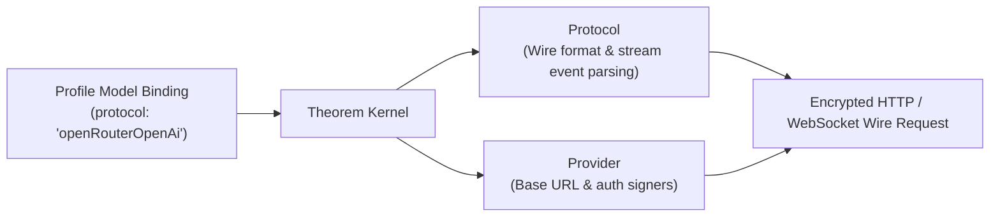

# Supported Protocols

A protocol defines the wire format used to speak to an upstream model provider. It parses streaming events, serializes multimodal inputs, translates tool calls, and extracts citations.

In Theorem, a protocol owns the wire transport and stream parsing, but has no knowledge of endpoints, credentials, or vault slots. Providers declare which protocols their endpoints serve, and profiles bind models to a specific protocol.

---

## Protocols vs Providers

Wire protocols and network endpoints are strictly separated:



* **Protocols Own the Wire**: They serialize requests into provider JSON bodies, decode SSE stream chunks, re-assemble tool call arguments, parse reasoning tokens, and extract web citations. Protocols never hold URLs, API keys, or key slots.
* **Providers Own the Destination**: They declare the base URL, authentication headers or query parameters, and which protocols their server hosts.

---

## Supported Protocols Matrix

A protocol declares which profile types it serves through its `endpoints` map. If a profile binds to a protocol that lacks an endpoint for its modality (for example, attempting to generate images using `openAi`), registration fails immediately at application startup.

| Protocol ID | Supported Modalities | Default Wire Path | Capabilities & Dialect Notes |
| :--- | :--- | :--- | :--- |
| **`geminiInteractions`** | `text`, `image`, `speech` | `/interactions` | Google Gemini multi-modal interaction API. Unified text, image, and voice endpoint. Supports server-side continuation state (`interactionId`). |
| **`openRouterOpenAi`** | `text`, `speech` | `/chat/completions`, `/audio/speech` | Extended OpenAI chat completions with prompt caching, deep reasoning replay (`reasoning_details`), and web search citations. |
| **`openAi`** | `text`, `speech` | `/chat/completions`, `/audio/speech` | Standard OpenAI-compatible chat completions and text-to-speech endpoints. |
| **`geminiLive`** | `live` | `/google.ai.generativelanguage.v1beta...` | Real-time bidirectional WebSockets for audio, camera video, and barge-in interruption handling. |
| **`openRouterImages`** | `image` | `/images` | Dedicated image generation endpoint with optional companion conversational text (`includeText`). |
| **`openRouterTranscriptions`** | `transcription` | `/audio/transcriptions` | Speech to text. Sends one inline voice clip and returns the words as the turn's text. |
| **`openRouterDecisions`** | `decision` | `/alpha/decisions` | Multi-question judgment against JSON state assets in a single synchronous call. |
| **`systemOne`** | `decision` | `/systemone` | TypeSafe decision evaluation protocol supporting image assets and long context flags. |
| **`geminiEmbeddings`** | `embedding` | `/models/{apiId}:embedContent` | Google vector generation supporting text, multimodal media inputs, and task-type routing. |
| **`openRouterEmbeddings`** | `embedding` | `/embeddings` | OpenAI-compatible text embedding endpoint. |
| **`ollamaEmbeddings`** | `embedding` | `/api/embed` | Local Ollama embedding protocol for self-hosted vector pipelines. |

---

## Protocol Options (`models.*.options`)

Because profile modality configuration is already defined by the profile type (`inputs`, `outputs`, `tools`, `guardrails`), a builder rarely needs to interact directly with protocols.

The only builder-facing surface on a protocol is its optional `options` schema, configured under `models.<alias>.options` in a profile:

```ts
models: {
  main: {
    protocol: 'openRouterOpenAi',
    provider: 'openrouter',
    apiId: 'anthropic/claude-3.5-sonnet',
    options: {
      cache: { mode: 'automatic', ttl: '5m' }, // Protocol-specific setting
    },
  },
}
```

### Supported Protocol Options

| Protocol ID | Option Key | Type | Description |
| :--- | :--- | :--- | :--- |
| **`openRouterOpenAi`** | `cache.mode` | `'automatic'` \| `'system'` | Enables OpenRouter KV prompt caching. `'automatic'` caches the full prompt; `'system'` caches instructions only. |
| | `cache.ttl` | `'5m'` \| `'1h'` | Time-to-live for cached prompt prefixes. |
| **`geminiInteractions`** | `store` | `boolean` | Whether Google stores the interaction server-side. |
| | `persistViaInteractionId` | `boolean` | Continues turns via server-stored `interactionId` rather than re-transmitting previous conversation history. Requires `store: true`. |
| **`systemOne`** | `images` | `boolean` | Enables visual asset inspection during state decision evaluation. |
| | `longContext` | `boolean` | Enables extended token window processing for large state payloads. |
| **`geminiEmbeddings`** | `taskType` | `string` | Semantic routing hint (`RETRIEVAL_QUERY`, `RETRIEVAL_DOCUMENT`, `CLASSIFICATION`). |
| | `outputDimensionality` | `number` | Truncates embedding vector output to a lower dimensionality. |
| **`ollamaEmbeddings`** | `truncate` | `boolean` | Whether local Ollama truncates input text exceeding model context. |
| | `dimensions` | `number` | Output embedding dimension size. |

Protocols without special options (`openAi`, `geminiLive`, `openRouterImages`, `openRouterDecisions`) declare an empty options schema (`z.strictObject({})`).

---

## Startup Verification

When `registerProfile()` runs, the kernel validates the binding against the protocol:

1. **Provider Check**: Confirms that the registered provider explicitly serves the bound protocol ID (`provider.serves`).
2. **Modality Check**: Confirms that the protocol supports the profile's modality (text, live voice, embeddings, images, speech, or decisions).
3. **Options Check**: Validates `models.*.options` against the protocol's Zod schema. Unrecognized options or malformed values throw a `TheoremError('config')` before any turns can run.

---

## Related Guides

* **[Model Bindings & Key Slots](5-1-model-bindings.md)**: Binding models to key slots, operational limits, and failover keys.
* **[Defining a Provider](5-2-defining-a-provider.md)**: Configuring endpoints, base URLs, and authentication signers.
* **[Provider Checkpoints & State](5-4-provider-checkpoints.md)**: Native checkpoints, continuation policies, and fallback warnings.
* **[Profiles & Modalities](2-1-profiles.md)**: Modality-specific profile configuration.
