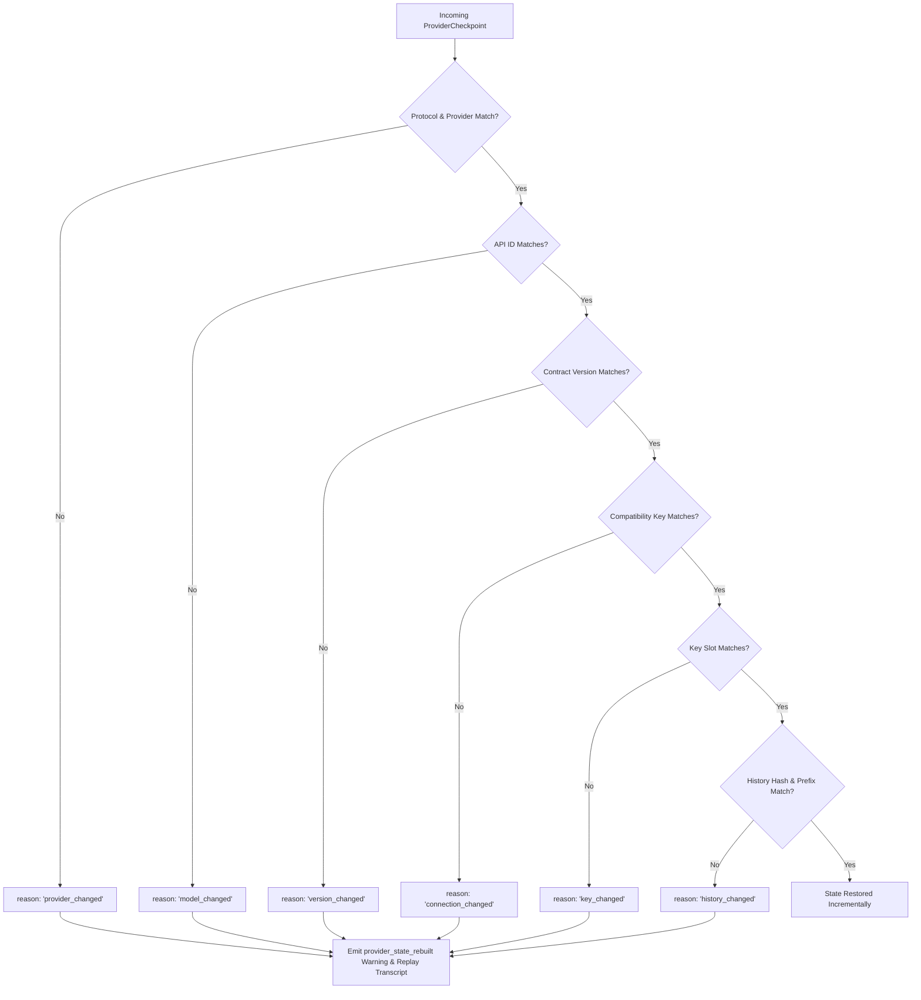

# Provider Checkpoints & State

Multi-turn conversations with language models encounter a fundamental architectural tension: upstream providers optimize inference using proprietary server-side caching, assistant threads, or native conversation handles, but distributed host applications require portable, fault-tolerant persistence that can fail over across models and providers without losing context.

Theorem resolves this tension through a **dual-layer state architecture**:
1. **Portable History Layer (`TurnHistoryMessage[]`)**: Universal, provider-agnostic transcripts maintained in open formats (`role`, `content`, `parts`, `thought`).
2. **Native Provider Checkpoint Layer (`ProviderCheckpoint`)**: Protocol-specific binary or JSON state captures emitted by provider adapters.

---

## The Dual-Layer Conversation Model

During multi-turn execution, the host persists both the portable history transcript and the optional native checkpoint:

```mermaid
flowchart TD
    subgraph Host["Host Application"]
        History["Portable History (TurnHistoryMessage[])"]
        Checkpoint["Native Checkpoint (ProviderCheckpoint)"]
    end

    subgraph Kernel["Theorem Engine"]
        Verify["historyHash & compatibilityKey Verification"]
        Fallback{"Drift Detected?"}
        Rebuild["Rebuild from History (provider_state_rebuilt)"]
        ResumeNative["Resume Native Protocol State"]
    end

    subgraph Upstream["Model Provider"]
        NativeSession["Native API Session / Cache"]
    end

    Host -->|runTurn({ history, providerState })| Verify
    Verify --> Fallback
    Fallback -->|Yes (Key, Model, or History Changed)| Rebuild
    Fallback -->|No (State Matches)| ResumeNative
    Rebuild -->|Full Transcript Replay| Upstream
    ResumeNative -->|Incremental Delta| NativeSession
```

If the upstream connection drops, an API key rotates, or the profile fails over to an alternative model, Theorem discards the native checkpoint and reconstructs the session context directly from the portable transcript.

---

## Continuation Policies (`providerContinuation.history`)

The profile's [`providerContinuation`](file:///Users/masudlewis/Development/theoremai/src/kernel/checkpoint.ts#L62-L74) block establishes who owns conversation memory:

```ts
import { registerProfile } from '@theoremjs/agents';

registerProfile({
  id: 'harbor.desk',
  type: 'text',
  // ... identity, models, tools, inputs, outputs
  providerContinuation: {
    history: 'host', // 'host' | 'stateless' | 'provider'
  },
  // ... turnBehaviour, guardrails, observability, labels
});
```

Continuation policies are scoped strictly to turn types (`text`, `image`, `speech`, and `live`). Profiles targeting `decision`, `embedding`, or `host` do not support continuation and reject this setting during validation.

### Policy Comparison

| Mode | Memory Sovereign | Checkpoint Payload | Failover & Migration Guarantee |
| :--- | :--- | :--- | :--- |
| **`'host'`** *(Default)* | Host application | Host passes both `history` and `providerState`. | **Zero Data Loss**: If the provider or model changes, state automatically falls back to portable transcript replay. |
| **`'provider'`** | Upstream provider | Host passes `providerState` alone; `history` is omitted. | **High Efficiency, High Coupling**: Fails over only if the host retains a backup copy of the transcript out-of-band. |
| **`'stateless'`** | None | Completion emits no checkpoint. | **Enforced Isolation**: Requests carrying `history` or `providerState` fail at ingress with a `request` error. |

---

## Checkpoint Structure

A [`ProviderCheckpoint`](file:///Users/masudlewis/Development/theoremai/src/kernel/checkpoint.ts#L8-L23) encapsulates the upstream state alongside validation digests:

```ts
interface ProviderCheckpoint {
  protocol: string;                 // Protocol identifier (e.g., 'anthropic', 'openai')
  provider: string;                 // Provider registry identifier
  version: number;                  // Protocol continuation contract schema version
  apiId: string;                     // Upstream model API identifier
  keySlot?: KeySlot;                // Key slot used ('primary' | 'secondary' | string)
  compatibilityKey: string;         // Hash of provider connection and keyed options
  coveredHistoryLength: number;     // Number of transcript messages covered by this state
  coveredHistoryHash: string;       // SHA-256 digest of the covered transcript prefix
  data: unknown;                    // Protocol-specific state payload (validated by schema)
  wireCallIds?: Record<string, string>; // Mapping between host tool IDs and upstream wire IDs
}
```

### Transcript Prefix Verification (`historyHash`)

Before applying a native checkpoint, Theorem computes a canonical SHA-256 digest of the portable transcript up to `coveredHistoryLength`. The hashing process normalizes whitespace, canonicalizes user-data fences, and strips unshared metadata to guarantee deterministic cross-platform equivalence.

If a host edits, truncates, or prepends messages in earlier parts of the transcript, `coveredHistoryHash` does not match, and Theorem treats the native state as invalidated.

---

## State Drift & Fallback Warnings

When restoring state, Theorem verifies seven compatibility constraints:



When drift occurs, execution does not crash. The engine falls back to transcript replay and emits a warning event:

```ts
export interface ProviderWarning {
  code: 'provider_state_rebuilt';
  reason:
    | 'provider_changed'    // Checkpoint belonged to another provider
    | 'model_changed'       // Checkpoint belonged to another model
    | 'connection_changed'  // Base URL or transport options changed
    | 'key_changed'         // Key slot changed (e.g., fallback key triggered)
    | 'history_changed'     // History was edited or truncated prior to checkpoint
    | 'version_changed';    // Protocol serialization format version bumped
}
```

---

## Runner Execution Example

Host applications persist `providerState` across turns alongside transcript messages:

```ts
import { runTurn } from '@theoremjs/agents';

// Turn 1: Initial user message
const turn1 = await runTurn({
  profile: 'harbor.desk',
  input: { text: 'Verify cargo container MSKU9012345.' },
});

// Host application saves turn1.history and turn1.providerState in its database
const savedHistory = turn1.history;
const savedCheckpoint = turn1.providerState;

// Turn 2: Follow-up message resuming native session
const turn2 = await runTurn({
  profile: 'harbor.desk',
  providerState: savedCheckpoint,
  input: {
    history: savedHistory,
    text: 'Inspect customs seal for container MSKU9012345.',
  },
});
```

---

## Stateless Turns

For security-sensitive or high-throughput batch workloads where context retention is unwanted, configure `history: 'stateless'`:

```ts
registerProfile({
  id: 'harbor.manifest_stateless',
  type: 'text',
  // ... identity, models, tools, inputs, outputs
  providerContinuation: {
    history: 'stateless',
  },
  // ... turnBehaviour, guardrails, observability, labels
});
```

When `history: 'stateless'` is set:
1. Turn execution returns `providerState: undefined`.
2. Any caller attempting to pass `req.input.history` or `req.providerState` is rejected immediately during ingress with a `request` error:
   ```
   TheoremError: request - Profile is stateless; history or provider state cannot be continued
   ```
This guarantees that multi-turn history cannot accidentally leak into stateless decision or analysis turns.

---

## Related Guides

* **[Profiles & Continuation](2-1-profiles.md)**: Declaring `providerContinuation.history` on agent profiles.
* **[Model Bindings & Key Slots](5-1-model-bindings.md)**: Multi-model bindings, key slot failover, and fallback routing.
* **[Supported Protocols](5-3-supported-protocols.md)**: Wire protocols, SSE stream parsers, and modality matrix.
* **[History Compaction](2-3-history-compaction.md)**: Automated token counting, sliding windows, and transcript pruning.
