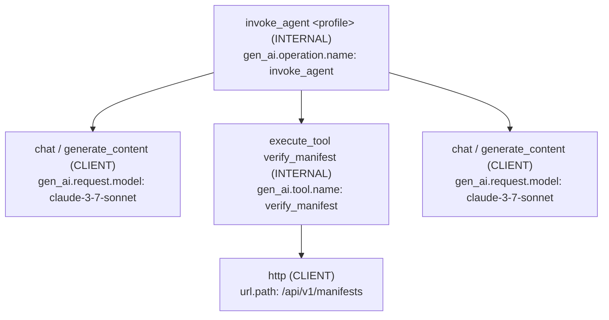
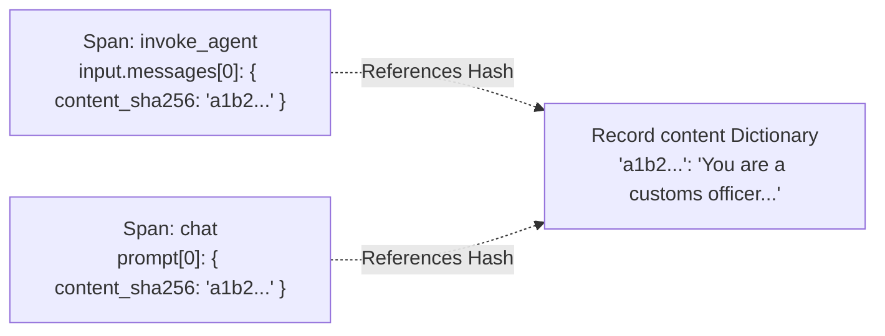

# Trace Spans & Semantic Conventions

Generative agent workflows present unique observability challenges: model calls generate variable-length streaming tokens, tool invocations execute multi-step nested pipelines, and prompts repeatedly serialize large document attachments and conversation histories. Emitting naive OpenTelemetry traces for every turn leads to excessive network overhead and duplicate payload storage.

Theorem resolves this with a native, deterministic tracing engine built directly into the kernel:
1. **Semantic Convention Compliance**: Follows OpenTelemetry (OTel) Generative AI Semantic Conventions (`gen_ai.*`) and OpenInference specifications (`openinference.span.kind`, `llm.*`).
2. **Content Interning**: Scrubbed text, instructions, and tool payloads are hashed via SHA-256 and stored once in a dedicated record dictionary (`content`), with spans referencing content by hash to eliminate payload bloat.
3. **W3C Context Propagation**: Supports standard `traceparent` and `tracestate` headers for distributed tracing across microservices.

---

## Span Hierarchy & Topology

A single turn execution generates a structured tree of nested spans representing each operational boundary:



### Span Types (`TraceSpanType`)

Theorem defines ten distinct span categories ([`trace-catalog.ts`](file:///Users/masudlewis/Development/theoremai/src/observability/trace-catalog.ts#L94-L105)):

| Span Type | Span Name Pattern | Span Kind | Role |
| :--- | :--- | :--- | :--- |
| **`turn`** | `invoke_agent <profile>` | `INTERNAL` | Root span for standard conversational turns (`runTurn`). Tracks overall latency, total tokens, and stop conditions. |
| **`session`** | `invoke_agent <profile>` | `INTERNAL` | Root span for duplex WebRTC/WebSocket audio and video streams (`runSession`). |
| **`call`** | `chat` / `generate_content` / `embeddings` | `CLIENT` | Outgoing model inference request to an upstream provider adapter. Tracks prompt tokens, completion tokens, and reasoning tokens. |
| **`tool`** | `execute_tool <toolId>` | `INTERNAL` | Execution of a function, HTTP, MCP, or delegated agent tool. |
| **`http`** | `http` | `CLIENT` | Individual HTTP request attempt initiated by remote REST tools. |
| **`cutout`** | `cutout` | `INTERNAL` | Automated history compaction, message trimming, or image cropping steps. |
| **`decision`** | `decide <contract>` | `INTERNAL` | Single-pass evaluation of JSON state and decision criteria (`runDecision`). |
| **`evaluation`** | `theorem.eval.trial` / `theorem.eval.run` | `INTERNAL` | Benchmark trials and evaluation suite executions. |
| **`host`** | `<custom-name>` | `INTERNAL` | Custom application spans recorded by host code via span handles. |

---

## Semantic Attribute Catalog

Spans record structured key-value attributes conforming to OpenTelemetry GenAI standards alongside Theorem runtime metrics.

### 1. Model Inference (`call`)
* **`gen_ai.operation.name`**: Operation kind (`'chat'`, `'generate_content'`, `'decide'`, `'embeddings'`).
* **`gen_ai.request.model`**: Upstream model identifier (e.g., `'claude-3-7-sonnet'`, `'gemini-2.5-flash'`).
* **`gen_ai.system`**: Provider identifier (e.g., `'anthropic'`, `'gemini'`).
* **`gen_ai.usage.input_tokens`**: Tokens read by the model.
* **`gen_ai.usage.output_tokens`**: Tokens generated by the model.
* **`gen_ai.usage.reasoning.output_tokens`**: Tokens consumed by internal model thinking/reasoning.
* **`theorem.usage.cost_usd`**: Precise dollar cost calculated from token metrics and provider rate cards.

### 2. Tool Calls (`tool`)
* **`gen_ai.tool.name`**: Registered tool identifier.
* **`gen_ai.tool.call.id`**: Unique tool invocation ID generated by the model.
* **`theorem.tool.origin`**: Tool implementation type (`'local'`, `'builtin'`, `'http'`, `'mcp'`, `'delegated'`).
* **`theorem.tool.permission`**: Execution permission tier (`'auto'`, `'session_consent'`, `'always_confirm'`).
* **`theorem.tool.outcome`**: Settlement state:
  * `ok`: Tool executed successfully and returned a result.
  * `error`: Tool handler threw an error.
  * `denied`: User, hook, or guardrail rejected execution.
  * `gated`: Suspended awaiting human confirmation or OAuth sign-in.
  * `paused`: Handed back to host.
  * `cancelled`: Turn aborted before execution completed.

### 3. Agent Lifecycle & Terminal State (`turn`)
* **`gen_ai.conversation.id`**: Host-supplied conversation identifier (`req.conversationId`).
* **`gen_ai.agent.id`**: Profile identifier.
* **`theorem.stop.kind`**: Why the turn concluded:
  * `completed`: Model delivered its final answer.
  * `length`: Model hit its output token cap (`maxOutputTokens`).
  * `gate`: Turn suspended awaiting human approval or OAuth sign-in.
  * `step_limit`: Exhausted maximum allowed tool loops (`maxSteps`).
  * `filtered`: Response blocked by safety guardrails.
  * `provider_error`: Upstream API failure.
  * `cancelled`: Client aborted execution via `AbortSignal`.

---

## Content Interning Architecture

Traditional trace exporters dump complete prompt strings and JSON arguments into every span, causing trace payloads to balloon into tens of megabytes. 

Theorem structures each trace as a [`TraceRecord`](file:///Users/masudlewis/Development/theoremai/src/observability/trace-schema.ts#L106-L117):

```ts
export interface TraceRecord {
  v: 3;                                 // Schema version (TRACE_VERSION = 3)
  schemaUrl: string;                    // OpenTelemetry schema URL
  resource: TraceAttributes;           // Host process attributes (e.g., service.name)
  metadata?: Record<string, unknown>;  // Host request metadata passed untouched
  spans: TraceSpan[];                  // Flattened list of spans (root first)
  content: Record<string, string>;     // SHA-256 hash -> exact scrubbed text
}
```



Before hashes are generated:
1. Sensitive data, API keys, and injection attempts are redacted according to active guardrails.
2. The scrubbed string is hashed via SHA-256.
3. The content is placed into `record.content[sha256Hex]`.
4. Spans carry only `{ content_sha256: sha256Hex }` references.

When sending traces to third-party collectors (such as Arize Phoenix or OpenTelemetry Jaeger), Theorem's exporters inline the content automatically.

---

## Distributed Context & Span Links

### W3C Context Propagation
Host applications connect Theorem turns into distributed traces by supplying W3C `traceparent` headers on requests ([`types.ts`](file:///Users/masudlewis/Development/theoremai/src/kernel/types.ts#L990-L995)):

```ts
import { runTurn } from '@theoremjs/agents';

const turn = await runTurn({
  profile: 'harbor.desk',
  traceparent: '00-4bf92f3577b34da6a3ce929d0e0e4736-00f067aa0ba902b7-01',
  input: { text: 'Verify manifest for vessel Northern Star.' },
});
```

* The root `invoke_agent` span becomes a child of the incoming traceparent.
* Remote HTTP tools (`3.1.2`) automatically inject downstream `traceparent` headers when calling external microservices.

### Span Links (`TraceSpanLink`)
When turns pause or resume across asynchronous boundaries, Theorem establishes causal edges via span links:

| Link Kind | Trigger Condition |
| :--- | :--- |
| **`resume`** | A turn picks up after a tool gate was approved or rejected (`runTurn({ resumeFrom })`). Links the new turn to the original gated turn's root span. |
| **`continue`** | A turn resumes generation after hitting token limits (`resumption.allowContinue`). |
| **`retry`** | Automatic retry of a failed model call after transient provider rate limiting or network drops. |
| **`trial`** | Connects an individual evaluated trial span to its parent benchmark suite run. |

---

## Related Guides

* **[Telemetry Sinks & Exporters](6-2-telemetry-destinations.md)**: Configuring profile observability, destination registries, and OTLP exporters.
* **[Evaluations & Benchmarks](6-3-evals-and-benchmarks.md)**: Running automated benchmark suites and grading trial traces.
* **[The Four Boundaries](4-1-the-four-boundaries.md)**: Ingress, egress, tool call, and tool result inspection events.
* **[Turn Resumption & Steering](2-4-turn-resumption.md)**: Causal span links for gated turns, resumption, and continue tokens.
