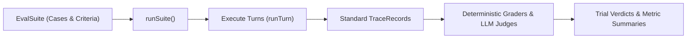

# Evaluations & Benchmarks

Evaluating generative agents requires testing non-deterministic behavior across probabilistic model generations, multi-step tool call sequences, and adversarial safety boundaries. Ad-hoc testing scripts that inspect raw string replies fail to capture tool side effects, token costs, or guardrail decisions.

Theorem provides a native evaluation framework built on a foundational architectural invariant: **graders inspect standardized trace records (`TraceRecord`) and nothing else**.



Because evaluations grade the trace rather than custom runner hooks:
1. **Decoupled Verification**: Any execution that produces a standard trace record (live runs, on-disk logs, or synthetic tests) can be evaluated identically.
2. **Observability Completeness**: If a grader requires a fact the trace does not capture, the trace contract is incomplete, not the grader.

---

## Suite Architecture (`EvalSuite` & `EvalCase`)

An evaluation suite pairs a target agent profile with test cases, repetition policies, and graders ([`types.ts`](file:///Users/masudlewis/Development/theoremai/src/evals/types.ts#L125-L145)):

```ts
import type { EvalSuite } from '@theoremjs/agents';

export const customsSuite: EvalSuite = {
  id: 'customs-compliance-v1',
  profile: 'harbor.customs',
  trials: {
    repeat: 3,        // Number of executions per case
    pass: 'all',      // 'all' (pass^k) | 'any' (pass@k) | { atLeast: 2 }
  },
  cases: [
    {
      id: 'verify-valid-manifest',
      kind: 'capability', // 'capability' (new feature) | 'regression' (prevent backsliding)
      difficulty: 2,      // 1 (trivial) to 5 (complex)
      input: {
        text: 'Verify cargo container MSKU9012345.',
      },
      expect: {
        tools: ['inspect_container', 'validate_seal'],
        answer: {
          accepted: ['clear', 'passed inspection'],
          rejected: ['detain', 'quarantine'],
        },
      },
    },
  ],
};
```

### Multi-Trial Repetition (`trials.repeat`)
Single-trial evaluations (`repeat: 1`) cannot distinguish non-deterministic model variance from actual capability changes. Theorem requires declaring `repeat` alongside a pass rule:
* **`'all'`** ($pass^k$): Every repeated trial must pass for the case to pass. Measures strict consistency and reliability.
* **`'any'`** ($pass@k$): At least one trial must pass. Measures model capability or potential.
* **`{ atLeast: n }`**: At least $n$ trials must pass out of `repeat`.

---

## Grader Taxonomy

Graders evaluate a completed [`Trial`](file:///Users/masudlewis/Development/theoremai/src/evals/types.ts#L159-L173), returning structured verdicts (`EvalResult`) with numeric scores, categorical labels, and failure reasons.

### 1. Code Graders (Deterministic)

Deterministic graders inspect trace attributes without invoking additional LLMs:

```ts
import { 
  answer, 
  toolTrajectory, 
  guardrail, 
  budget, 
  stopKind 
} from '@theoremjs/agents';

// Verify answer phrasing
const answerGrader = answer({
  accepted: ['order confirmed', 'tracking number generated'],
  partial: ['processing order'],
  rejected: ['out of stock', 'payment failed'],
});

// Verify sequence of tool invocations
const toolGrader = toolTrajectory({
  mode: 'exact_sequence', // 'exact_sequence' | 'includes' | 'subset'
  expected: ['fetch_inventory', 'charge_card', 'send_receipt'],
});

// Verify guardrails properly blocked malicious input
const safetyGrader = guardrail({
  boundary: 'ingress',
  rule: 'detect.injection',
  expectedAction: 'block',
});

// Enforce token and dollar ceilings
const costGrader = budget({
  maxCostUsd: 0.05,
  maxTotalTokens: 4000,
});
```

### 2. Model Judges (LLM-as-a-Judge)

For nuanced qualities like helpfulness, professional tone, or complex criteria compliance, [`judge`](file:///Users/masudlewis/Development/theoremai/src/evals/graders/judge.ts#L15) invokes a designated judge model against defined rubrics:

```ts
import { judge, rubric } from '@theoremjs/agents';

const toneGrader = judge({
  model: 'gemini-2.5-pro',
  rubric: rubric('conversational-politeness'),
});
```

Judge calls automatically link their execution to the parent trial trace via W3C `traceparent`, preserving complete auditability.

---

## Running Benchmark Suites

Execute suites programmatically using [`runSuite`](file:///Users/masudlewis/Development/theoremai/src/evals/run.ts#L30):

```ts
import { runSuite, summarizeRun } from '@theoremjs/agents';
import { customsSuite } from './customs.suite.ts';

// Execute the evaluation suite across all cases and trials
const suiteRun = await runSuite(customsSuite, {
  concurrency: 4, // Concurrent case runs
});

// Summarize pass rates, token metrics, and cost breakdowns
const summary = summarizeRun(suiteRun);

console.log(`Suite ${summary.suiteId}: ${summary.passed ? 'PASSED' : 'FAILED'}`);
console.log(`Pass Rate: ${(summary.passRate * 100).toFixed(1)}%`);
console.log(`Total Spend: $${summary.totalCostUsd.toFixed(4)}`);
```

Each trial's outcome is recorded as a standard trace record, allowing evaluation runs to be exported to any registered trace destination or visualized in external dashboards.

---

## Related Guides

* **[Trace Spans & Semantic Conventions](6-1-trace-spans-catalog.md)**: The pure trace record schema (`TraceRecord`) inspected by graders.
* **[Telemetry Sinks & Exporters](6-2-telemetry-destinations.md)**: Exporting evaluation run records to external dashboards and JSONL sinks.
* **[Profiles & Modalities](2-1-profiles.md)**: Defining target agent profiles and model bindings evaluated by test suites.
* **[Guardrails & Boundaries](4-1-the-four-boundaries.md)**: Safety boundaries verified by deterministic guardrail graders.
