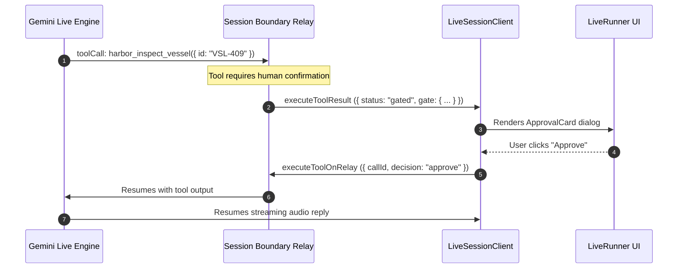

# Realtime Voice, Video & AudioWorklets

Building responsive, bidirectional voice and video agents in the browser requires low-latency audio capture, streaming playback, barge-in interruption handling, and acoustic echo suppression. Coordinating these media streams on the main JavaScript thread causes UI frame drops, audio stuttering, and dropped network packets.

Theorem implements a dedicated native browser media pipeline in [`@theoremjs/web/client`](file:///Users/masudlewis/Development/theoremai/web/README.md) and [`@theoremjs/react/live`](file:///Users/masudlewis/Development/theoremai/react/README.md). Heavy audio processing runs entirely in background `AudioWorklet` threads, while the Web Audio API coordinates low-latency, gapless voice synthesis.

---

## The Realtime Media Architecture

Duplex streaming connects the browser to an upstream live provider via a WebSocket relay. Rather than requiring WebRTC peer negotiation and ICE/STUN/TURN infrastructure, Theorem streams native PCM audio chunks and JPEG video frames directly over a bidirectional WebSocket (`/api/live/relay`):

```mermaid
flowchart TD
    subgraph Browser["Browser Client (@theoremjs/web/client)"]
        Mic["Microphone Stream"] --> Worklet["AudioWorklet (mic-capture.js)<br/>16kHz PCM Downsampling"]
        Worklet --> QuietGate{"Quiet-Mic Gate<br/>(Speaker Bleed Guard)"}
        QuietGate -->|16kHz PCM Chunks| WSOut["WebSocket Outbound (/api/live/relay)"]
        
        Camera["Camera Video Stream"] --> FrameCap["Frame Capture (Canvas JPEG)"]
        FrameCap -->|client.sendVideo()| WSOut
        
        WSIn["WebSocket Inbound"] --> Decode["24kHz PCM Decoder"]
        Decode --> AudioCtx["Web Audio API (AudioContext)<br/>Gapless Playback Scheduler"]
        AudioCtx --> Speaker["Device Speaker"]
        
        WSIn --> Interruption{"Barge-In Detector"}
        Interruption -->|client.cancelPlayback()| AudioCtx
    end

    subgraph Server["Server Relay (@theoremjs/web/server)"]
        WSOut --> Boundary["Session Boundary<br/>prepareLiveOpen()"]
        Boundary --> Upstream["Gemini Live Gateway<br/>(runSession)"]
        Upstream --> WSIn
    end
```

---

## 1. Background Audio Ingestion (`AudioWorklet`)

Microphone input is captured at hardware sample rates (typically 44.1kHz or 48kHz) and downsampled off the main thread to 16-bit 16kHz linear PCM, matching upstream provider specifications.

### Zero-Config Worklet Ingestion

When instantiating [`LiveSessionClient`](file:///Users/masudlewis/Development/theoremai/web/src/client/live-client.ts), audio processing is completely automated:

1. `client.connect()` requests microphone access via `navigator.mediaDevices.getUserMedia({ audio: true })`.
2. The client instantiates a browser `AudioContext` and loads the internal `mic-capture.js` worklet module.
3. The worklet converts incoming multi-channel float audio into single-channel 16kHz 16-bit signed integer PCM.
4. Downsampled frames stream over the WebSocket without blocking UI rendering or main-thread React updates.

Metering callbacks (`onInputLevel` and `onOutputLevel`) report normalized energy levels in the range $[0, 1]$ computed via `float32RmsToLevel`, directly driving visual waveform bars such as [`InkWaveform`](file:///Users/masudlewis/Development/theoremai/react/src/components/InkWaveform.tsx).

---

## 2. Gapless 24kHz Playback Scheduling

Upstream providers return streaming model audio in variable-length 24kHz PCM chunks. Naively playing each chunk with `HTMLAudioElement.play()` results in audible clicks and gaps between network packets.

[`LiveSessionClient`](file:///Users/masudlewis/Development/theoremai/web/src/client/live-client.ts) manages a buffer queue on the Web Audio API clock:

```ts
// Schedule incoming PCM chunks along the Web Audio clock
let nextPlayTime = audioContext.currentTime;

function enqueueAudioChunk(pcmData: Float32Array, sampleRate = 24000) {
  const buffer = audioContext.createBuffer(1, pcmData.length, sampleRate);
  buffer.copyToChannel(pcmData, 0);

  const sourceNode = audioContext.createBufferSource();
  sourceNode.buffer = buffer;
  sourceNode.connect(audioContext.destination);

  // Guarantee gapless continuity: schedule immediately after prior chunk
  const startTime = Math.max(audioContext.currentTime, nextPlayTime);
  sourceNode.start(startTime);
  nextPlayTime = startTime + buffer.duration;
}
```

By queuing chunks relative to `audioContext.currentTime`, audio playback remains perfectly smooth even when network packets arrive in jittered batches.

---

## 3. Barge-In Interruption & Acoustic Gating

Conversational realism requires that a user can interrupt the model mid-sentence. However, device speakers often bleed audio back into the microphone, which naive detection engines mistake for user speech, causing the agent to interrupt itself.

Theorem employs a two-tier acoustic defense:

### Instant Buffer Flushing (Barge-In)
When the server emits an interruption signal or the user speaks over the agent, [`LiveSessionClient.cancelPlayback()`](file:///Users/masudlewis/Development/theoremai/web/src/client/live-client.ts) immediately stops and disconnects all scheduled `AudioBufferSourceNode` instances, resetting `nextPlayTime` to `audioContext.currentTime`. The model ceases speaking with zero perceptual latency.

### The Quiet-Mic Echo Gate
While model audio is actively playing through the speaker, Theorem's client-side microphone gate ([`live-mic-forward.ts`](file:///Users/masudlewis/Development/theoremai/web/src/client/live/live-mic-forward.ts)) enforces `BARGE_IN_RMS_WHILE_SPEAKING = 0.05`:
1. Low-amplitude acoustic bleed from the speakers (alongside keyboard clicks and ambient room noise) sits below 0.05 RMS and is dropped locally before transmission.
2. High-amplitude intentional user speech immediately crosses 0.05 RMS, streaming to the relay and triggering server-side interruption.

---

## 4. Video & Multimodal Camera Streaming

Realtime sessions ingest live video frames from device cameras over the same WebSocket connection.

### Headless Video Dispatch

Custom applications can capture frames from any HTML5 video stream and transmit them using `client.sendVideo`:

```ts
import { LiveSessionClient } from '@theoremjs/web/client';

const client = new LiveSessionClient({
  profile: 'harbor.live_dispatch',
  relayUrl: 'wss://api.example.com/api/live/relay',
});

await client.connect();

// Capture a frame from an off-screen canvas at 400ms intervals
function captureAndSendFrame(videoElement: HTMLVideoElement, canvas: HTMLCanvasElement) {
  const ctx = canvas.getContext('2d');
  if (!ctx) return;
  canvas.width = videoElement.videoWidth;
  canvas.height = videoElement.videoHeight;
  ctx.drawImage(videoElement, 0, 0);

  // Encode as JPEG at 0.62 quality to optimize network bandwidth
  const dataUrl = canvas.toDataURL('image/jpeg', 0.62);
  const base64Jpeg = dataUrl.split(',')[1];
  if (base64Jpeg) {
    client.sendVideo(base64Jpeg);
  }
}
```

### Turnkey React Video

For turnkey applications, [`LiveRunner`](file:///Users/masudlewis/Development/theoremai/react/README.md) from `@theoremjs/react/live` automates camera acquisition, device toggling (`facingMode: 'user' | 'environment'`), canvas downsampling (640x480 at 400ms intervals), and video preview rendering:

```tsx
import { LiveRunner } from '@theoremjs/react/live';
import type { LiveProfileInterface } from '@theoremjs/agents/interface';

interface CallProps {
  iface: LiveProfileInterface;
}

export function VesselDispatchCall({ iface }: CallProps) {
  return (
    <LiveRunner
      iface={iface}
      connection={() => ({
        relayUrl: 'wss://api.example.com/api/live/relay',
        profile: 'harbor.live_dispatch',
      })}
    />
  );
}
```

---

## 5. Live Tool Execution & Mid-Call Gates

Models can execute tools during an active voice stream without closing the WebSocket connection:



If a tool requires user approval, the call does not drop. The audio connection remains open in a listening state while the UI renders a modal approval card. Once approved, the tool result is returned over the WebSocket, and the agent continues speaking naturally.

---

## Headless Client Management

Instantiate and manage realtime sessions using [`LiveSessionClient`](file:///Users/masudlewis/Development/theoremai/web/src/client/live-client.ts):

```ts
import { LiveSessionClient, type LiveSessionStatus } from '@theoremjs/web/client';

const client = new LiveSessionClient({
  profile: 'harbor.live_dispatch',
  relayUrl: 'wss://api.example.com/api/live/relay',
  voiceIngress: true,
  onStatusChange: (status: LiveSessionStatus) => {
    console.log('Call status:', status); // 'connecting' | 'connected' | 'speaking' | 'listening' | 'reconnecting' | 'disconnected' | 'error'
  },
  onTranscript: (text: string, isUser: boolean, meta?: { interim?: boolean }) => {
    console.log(`${isUser ? 'User' : 'Agent'}${meta?.interim ? ' (interim)' : ''}: ${text}`);
  },
  onInputLevel: (level: number) => {
    // Input mic volume (0.0 to 1.0)
  },
  onOutputLevel: (level: number) => {
    // Model output speaker volume (0.0 to 1.0)
  },
  onError: (error: Error) => {
    console.error('Live call failure:', error);
  },
});

await client.connect();

// Mute/unmute microphone
const isMuted = client.toggleMute();

// Send text utterance mid-call
client.sendText('Vessel VSL-409 has reported clearance.');

// Clean disconnect
client.disconnect();
```

If a network interruption drops the WebSocket, [`LiveSessionClient`](file:///Users/masudlewis/Development/theoremai/web/src/client/live-client.ts) automatically attempts reconnection with exponential backoff (`[500, 1000, 2000, 4000, 8000]` ms) and resumes the session state using the provider's active continuation checkpoint.

---

## Related Guides

* **[Live Profiles](2-1-2-live-profiles.md)**: Declaring duplex audio, voice parameters, and context compression on the profile.
* **[Headless Web & Transport](7-1-headless-web-and-transport.md)**: Web-standard server route dispatchers and conversation stores.
* **[Headless React Hooks](7-2-react-hooks.md)**: Consuming chat, decision, and embedding transports in React.
* **[Turnkey Astryx UI Components](7-4-astryx-ui-components.md)**: Pre-assembled `<LiveRunner />` console with visual waveforms and captions.
