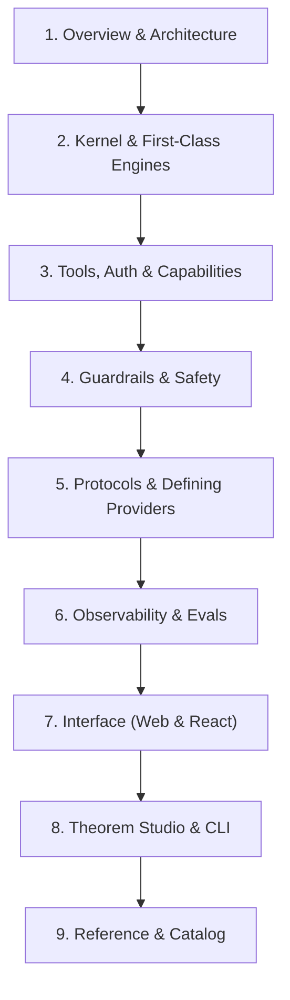

# Theorem Docs v2: Architecture & Alignment Scratchpad

> [!NOTE]
> Refined structure reflecting:
> 1. All engines (Text, Live, Decision, Embedding) are **first-class** in the Kernel.
> 2. **Inputs & Outputs** are part of the core agent contract in Kernel.
> 3. **Tools** covers declarations, gates, Auth/OAuth, MCPs, and **liquid tool labels** (`LabelTemplate`).
> 4. **Kernel Labels** covers the error and system string dictionary (`overrideLabels()`).
> 5. **Evals** is placed under **Observability**.
> 6. **Interface** covers both headless web integration and the pre-designed React package.

---

## 1. Information Architecture (The Tree)

---

### Group I: Overview & Architecture
* **1.1 Getting Started**
  * Installation (`npm`, `deno`), the 4-package ecosystem (`@theoremjs/agents` foundation, `@theoremjs/web`, `@theoremjs/react`, `@theoremjs/studio`).
  * Running the canonical `firstTurn` program.
* **1.2 Architecture Map**
  * The core invariants: *"Host decides, Theorem runs"* and *Zero Ambient Authority*.
  * Architecture map bridging natural language concepts to package modules.

---

### Group II: Agent Profiles & Execution
* **2.1 Profiles**
  * Core specification: `defineProfile`, identity, and persona.
  * Private system prompt shielding (`{ private: string }`).
  * Input contracts (`inputs`): text, attachments, voice, slots, and context injection.
  * Output contracts (`outputs`): stream modes (`delta` vs `sse`) and stream thought suppression (`streamThoughts`).
  * High-level specification map across operational policies.
  * Startup validation, registry lifecycle, and execution overview.
  * **2.1.1 Text Profiles**: Modality-specific configuration (`outputs.structured`, `outputs.validation`, `turnBehaviour.atStepLimit`) and invocation via **`runTurn()`** (TurnRequest shape, streaming event lifecycle).
  * **2.1.2 Live Profiles**: The **`live` block** (`ingress`, `voice`, `vad`, `sessionResumption`, `contextCompression`) and invocation via **`runSession()`** (WebSockets, bidirectional audio/video frames, interruption handling).
  * **2.1.3 Decision Profiles**: The **`decision` block** (`contract`), JSON state schema (`inputs.state`), model `timeoutMs`, and invocation via **`runDecision()`** (evaluating state against rubrics, `DecisionVerdict`).
  * **2.1.4 Image Profiles**: The **`image` block** (`aspectRatio`, `resolution`, `mimeType`, `quality`, `n`, `seed`, `includeText`) and invocation via `runTurn()` for media generation.
  * **2.1.5 Speech Profiles**: The **`speech` block** (`voice`, `style`, `speed`, `format`) and invocation via `runTurn()` for text-to-speech synthesis.
  * **2.1.6 Embedding Profiles**: Vector dimensionality, media channels, and invocation via **`runEmbedding()`** (vector representation generation).
  * **2.1.7 Host Profiles**: Governed passthrough to the tool registry without a model (`tools`, `guardrails.network`, `guardrails.detect`) and execution via **`invokeTool()`**.
* **2.2 Model Bindings**
  * The Model Triad: Protocol, Provider, Binding.
  * Multi-protocol diagram: 3 protocols, 4 providers, uniform abstraction.
  * Declaring bindings: literal data vs `registerProvider().model()` helper.
  * Credential slots & the vault: `keySlot`, `fallbackKeySlot`, and runtime vault resolution.
  * Multi-model routing: `defaultModel` and `allowModelSelect`.
  * Reasoning effort tiers: `efforts`, `defaultEffort`, `allowEffortSelect`, and `summaries`.
  * Execution budgets: `limits` (`operationTimeoutMs`, `maxWireResponseBytes`, `maxStepBytes`, `maxPendingToolCalls`).
* **2.3 History Compaction**
  * Preserving context: why long-running conversations require automated compaction.
  * The `compaction: CompactionSpec`: `maxTokens`, `compactAt`, `previousExchanges` (`0`, `≥ 1`, `(0, 1)`), `meter` (`'history'` vs `'input'`).
  * Compaction timing strategies: Synchronous in-turn (`timing: 'before'`) vs Asynchronous host-driven (`timing: 'after'`).
  * Host execution via `compactHistory()` and the `done.compaction` signal.
  * Mechanics & resilience: exchange splitting, tool call sanitization, summary tagging, and fault-tolerant fallbacks.
* **2.4 Turn Resumption & Steering**
  * `turnBehaviour.resumption`: `allowContinue`, `autoContinue`, `maxContinues`.
  * Resuming from tool gates (`approve`, `abandon`, modified inputs) and live session resumption handles (`sessionResumptionHandle`).
  * Mid-turn steering (`allowSteering`), stage events, and injecting user affordances.
* **2.5 Lifecycle Hooks & Interception**
  * `onStage`: Observing stage transitions and injecting affordances mid-turn.
  * `onAgentCall`: Intercepting, shaping, or gating nested sub-agent calls.
* **2.6 Kernel Labels & Errors**
  * Overridable system copy: why Theorem has no unreplaceable hardcoded strings.
  * System label dictionary, error taxonomy (`TheoremError`), and customizing copy via `overrideLabels()`.

---

### Group III: Tools, Auth & Capabilities
* **3.1 Tools & Execution Pipeline**
  * The checked execution pipeline, tool types taxonomy, core attributes (`access`, `permission`, `loadTier`, `paths`), and dynamic tool loading (`t1Policy`, `t2Loader`).
* **3.1.1 Function Tools**
  * Local JavaScript/TypeScript handlers, streaming generators, browser UI tools (`answeredBy: 'page'`), `ToolContext`, grounding citations (`sources`), and `uncheckedOutput`.
* **3.1.2 HTTP Tools**
  * Declarative REST endpoints, URL mapping (`pathParams`, `queryParams`, `bodyParam`), rate limits, timeout controls, and multimodal image extraction (`images`).
* **3.1.3 MCP Tools**
  * Model Context Protocol integration, server endpoints, and native MCP session pooling (`session.idleMs`, `session.max`, LRU eviction, parallel open deduplication).
* **3.1.4 Agent Tools**
  * Delegating to registered agent profiles, input/output schema derivation, `maxCallsPerTurn`, isolation, and `onAgentCall` interception.
* **3.2 Tool Permissions & Gates**
  * Gate policies: `auto`, `session_consent`, `always_confirm`.
  * Execution coordinators, approval cards, and `invokeTool()` resumption.
* **3.3 Auth & Credentials**
  * `ToolCredentialSource`: Managing credentials for authenticated tools without ambient leakage.
  * Credential placement (headers vs query), unauthenticated policies, typed secrets, and guarded domain resolution (`resolveHost`).
* **3.3.1 OAuth PKCE Flow**
  * Three-step PKCE lifecycle (`createOAuthPkceFlow`, `exchangeOAuthPkce`), stateless encrypted state, session-binding fixation defense, and automatic token refresh.
* **3.4 Liquid Tool Labels**
  * Activity labels defined directly on tool schemas (`LabelTemplate`).
  * Placeholders (`{path}`), conditional phrasing (`when:`), and real-time formatting (dates, numbers) for tool progress.

---

### Group IV: Guardrails & Safety
* **4.1 The Four Boundaries**
  * The boundary crossing model: User Text $\rightarrow$ Tool Args $\rightarrow$ Tool Results $\rightarrow$ Model Output.
* **4.2 Ingress Protection**
  * Prompt injection detection and sensitive data taint gates.
* **4.3 Egress Enforcement & Canaries**
  * Exfiltration defense; minting and binding canary tokens (`mintCanary`, `bindCanary`).
* **4.4 Network Safety & Secret Masking**
  * Preventing ambient SSRF and exfiltration through tool payloads.

---

### Group V: Protocols & Defining Providers
* **5.1 Supported Protocols**
  * What protocols mean in Theorem: wire schemas, transport (`http` vs `ws`), and event streaming.
  * Chat completion protocols, Google Interactions, Live WebSockets, Decision & Embedding protocols.
* **5.2 Defining a Provider**
  * Constructing a `Provider<Connection, Key>`, defining connection schemas, and authorizer signers (`sign(outgoing)`).
* **5.3 Model Bindings & Key Slots**
  * Binding models to protocols (`provider.model(...)`).
  * Effort levels, built-in tools (`builtInArgs`), key slots, and fallback key slots.

---

### Group VI: Observability & Evals
* **6.1 Trace Catalog & Spans**
  * W3C `traceparent` propagation; turn spans, tool spans, gate spans, and compaction records.
* **6.2 Telemetry Sinks & Exporters**
  * Exporting traces to OpenTelemetry, external logging sinks, or local storage.
* **6.3 Evals Harness & Quality**
  * Trial runners, graders, and evaluation rubrics.
  * Fuzzing guardrails and verifying behavioral contracts.

---

### Group VII: Interface (Web & React)
* **7.1 Web Platform (`@theoremai/web`)**
  * Framework-agnostic server handlers (`@theoremai/web/server`) and vanilla browser client (`@theoremai/web/client`).
  * Web-standard streaming, blocks, and transcript state without any UI framework.
* **7.2 Pre-Designed React Package (`@theoremai/react`)**
  * Client hooks: `useAgentChat`, `useLiveSessionClient`.
  * Pre-built Astryx UI components: chat transcripts, live voice visualizers, trace inspector drawers, and tool approval modals.

---

### Group VIII: Theorem Studio & CLI
* **8.1 Theorem Studio**
  * Interactive workbench: profile graph visualizer, draft workspaces, and three-proof safe saves.
* **8.2 CLI Commands**
  * Profile verification, running turns from the terminal, and local debugging workflows.

---

### Group IX: Reference
* **9.1 Symbol, Field & Label Catalog**
  * Interactive glossary of every type, field option, default, and label key across the packages.
